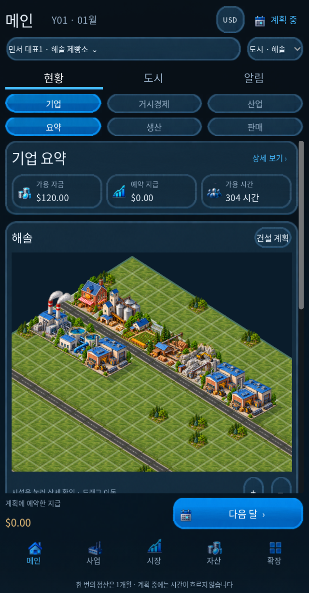

# Hora Economic Lab · 호라경제연구실

> **🔧 C# 재설계 진행 중 (2026-10-28~)** — [현행 피드백](docs/redesign/01-feedback.md) · [새 기획서](docs/redesign/02-game-design.md) · [작업 명세](docs/tasks/README.md)
> 규칙: [GitHub 사용](docs/standards/github-workflow.md) · [C# 코드](docs/standards/coding-conventions.md) · [개발 프로세스](docs/standards/development-process.md) · AI 지침 [AGENTS.md](AGENTS.md)
> 아래 내용은 현재 공개된 Godot 버전(v0.2.1) 기준입니다.

## C# 코어 개발

[PR #19](https://github.com/hddy774/project-hora/pull/19)의 M0 명세를 따라 `src/`에서 엔진 독립 코어를 개발합니다.
`.NET Standard 2.1 / C# 9` 라이브러리 두 개와 `.NET 8` 테스트·개발 도구를 분리했습니다.
현재 설치형 게임은 아래의 Godot v0.2.1이며, 새 코어의 진행 상황은 구현 PR별 수용 기준에서 확인할 수 있습니다.

```bash
dotnet restore --locked-mode
dotnet format --verify-no-changes
bash tools/check-code-rules.sh
dotnet build -c Release -warnaserror
dotnet test -c Release
```

SDK는 `global.json`, NuGet 버전은 `Directory.Packages.props`와 프로젝트별 잠금 파일에서 관리합니다.
새 클라이언트의 엔진은 기획서 Q1에 따라 별도로 결정합니다.

## 현재 공개 게임

**한 달의 결정이 사람·기업·도시와 세계 경제로 이어지는 경제 생태계 시뮬레이션 게임입니다.**

플레이어는 세계 안의 인물 한 명으로 취업·창업·투자·기업 경영·정치 활동을 선택합니다. 기업의 생산과 거래, 가계의 노동과 소비, 정부 예산과 국제 무역을 연결하고 그 결과와 원인을 관찰하는 게임을 개발하고 있습니다.

## 게임의 핵심

- **1턴 = 1개월:** 계획 중에는 시간이 멈추고 다음 달을 눌렀을 때만 정산합니다.
- **실제 도시에서 시작하는 경제:** 유한한 재고·자금·인력과 생산시설을 도시별로 계산하고 국가·세 대륙·세계로 집계합니다.
- **인물과 회사의 분리:** 개인 재산·직위·법인 자금·소유권을 구분하고 AI와 플레이어가 같은 행동 규칙을 사용합니다.
- **타일 건설과 공급망:** 건설 자재·시공 인력·기간, 생산 원료·운전자금·납기를 함께 관리합니다.
- **자유로운 경제 활동:** 산업·연구·소프트웨어·금융·정치·외교·공공조달을 연결하는 것이 전체 개발 목표입니다.
- **설명 가능한 결과:** 가격·재고·급여·공사 지연·현금 흐름의 원인을 실제 사건과 장부에서 추적합니다.



## 화면과 실행

세로 화면의 하단에는 **메인 · 사업 · 시장 · 자산 · 확장**의 다섯 탭을 둡니다. 월 진행 버튼은 별도 작업 영역입니다. UI·아이콘·건물 그래픽은 생성한 리소스로 구성하고 금액·날짜·진척은 실제 게임 데이터에서 표시합니다.

- [게임 소스와 실행 안내](games/monthly-economy/README.md)
- [전체 요구 추적표](games/monthly-economy/docs/requirements.md)
- [설계 결정과 미정 항목](games/monthly-economy/docs/decisions.md)
- [테스트·배포 검증 기록](games/monthly-economy/docs/validation.md)
- [공개 릴리스](https://github.com/hddy774/project-hora/releases)

**v0.2.1**은 생성 이미지 UI와 인물·산업·금융·정치·군수 모듈을 연결한 개발 릴리스입니다. [최신 다운로드](https://github.com/hddy774/project-hora/releases/latest)에서 실제 게시 파일과 검증 기록을 확인할 수 있습니다. 전체 기획의 남은 심도·장기 균형·실제 기기 검증은 요구 추적표와 검증 문서에 구분해 기록합니다.

화폐는 **미국 달러(USD)**입니다. **$1M=100만 달러**, **$1B=10억 달러**로 축약하며 원화 보기는 **1달러=1,000원**을 적용합니다. 상품은 실제 단위를 사용하고, 처리·건설·연구 등의 진행 상태를 막대로 확인합니다. 최신 릴리스 첨부는 **Android APK 한 개**입니다.

Godot 4.6.3 기반으로 오프라인 싱글플레이와 Android 세로 화면을 우선 검증합니다. 출시 기기 규모·균형 수치·온라인 기능은 확인된 결과와 설계 결정을 구분해 관리합니다.

## 이전 프로젝트

알파 익스체인지의 기존 배포 자료는 [보관 안내](docs/legacy/alpha-exchange.md)와 이전 릴리스에서 확인할 수 있습니다. 이 저장소의 메인 설명과 향후 호라경제연구실 릴리스는 **Hora Economic Lab · 호라경제연구실**을 기준으로 관리합니다.
