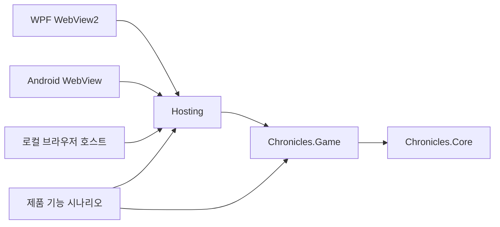

# 0.2.1 제품·호스트 경계

이 문서는 V021-H01/H02/H05/H07/H08/H10의 현재 소스 경계와 한계를 기록한다.
정본 프로젝트 소유자는 [repository_manifest.json](repository_manifest.json)이며,
검사기는 [validate-v021-product-boundary.py](../../scripts/validate-v021-product-boundary.py)다.
이 경계는 게임 엔진 없는 C# 구현을 대상으로 한다. Unity 프로젝트 생성이나 실행은
이번 제품의 완료 조건이 아니다.

## 현재 제품 그래프

화살표는 **사용하는 프로젝트 → 참조하는 프로젝트**다.



| 프로젝트 | 현재 책임 | 플랫폼·파일 접근 |
| --- | --- | --- |
| `Chronicles.Core` | `ProductInfo`, 명시적 상태의 `DeterministicRandom` | 엔진·OS·파일 접근 없음 |
| `Chronicles.Game` | `GameWorld` 단일 권위, 도메인 전이, 명령·필터된 조회, 메모리 바이트 codec | 엔진·OS 경로·파일 접근 없음 |
| `Chronicles.Hosting` | 직렬화된 세션, 슬롯 경로, 파일 저장·복구·원본 보존, Desktop facade | .NET 파일 시스템·lock·호스트 진단 |
| `Chronicles.Desktop` | WPF 수명 주기와 WebView2·공용 HTML | Windows UI·앱 데이터 경로 |
| `Chronicles.Android` | Android 수명 주기와 WebView·공용 HTML | Android UI·앱 전용 경로 |
| `Chronicles.Shell` | loopback HTTP·공용 HTML·JSON 세션 전달 | ASP.NET·로컬 호스트 경로 |

프로젝트 참조의 전이 폐쇄는 각 호스트 자신과 `Hosting`, `Game`, `Core`뿐이다.
이전 `Simulation`, `Queries`, `Runtime`, Windows SQLite `Persistence`, WPF
`MainWindow`는 현재 솔루션이나 호스트 빌드에 포함하지 않는다. 생성·전이·복원은
계속 `GameWorld`에서만 수행한다. 도메인 모듈의 후보 상태는 동일 물품·인물·재화 원장에
검증 후 적용하며 별도 세계를 실행하지 않는다.

## 실제 진입점과 표시 경계

| 호스트 | 실제 시작 경로 |
| --- | --- |
| Windows | `App.OnStartup` → `EcologyWindow` → `EcologyApplicationSession` → `GameSession` |
| Android | `[Activity(MainLauncher=true)] MainActivity.OnCreate` → `GameSession` → `NativeBridge` |
| 로컬 브라우저 | `Chronicles.Shell/Program.cs` → `GameSession`; `/api`는 JSON 요청 전달 |

`App.xaml`에는 `StartupUri`가 없다. 이전 `MainWindow`를 생성하는 현재 경로도 없다.
보관된 `MainWindow`와 새 `EcologyWindow`는 서로 다른 UI이며, 이전 화면을 새 제품의
검증 결과로 계산하지 않는다.

`SessionRequest`, `SessionReply`, `GameSession`, `GameSaveStore`의 CLR namespace는
`Chronicles.Game`을 유지한다. 이 형식의 **assembly owner는 `Chronicles.Hosting`**다.
`EcologyApplicationSession`도 namespace `Chronicles.Application`을 유지하지만 현재
Hosting 소유다. 이전 `Chronicles.Application` assembly를 참조한다는 뜻이 아니다.
이 배치는 기존 JSON bridge·호스트 소스 계약을 보존하며 참조 방향을 분명히 한다.

`GameSession`은 하나의 private `GameWorld`를 잠금 안에서 조정한다. UI에 전달되는
응답은 필터된 `GameView`와 `CommandResult`다. UI에는 `GameState`, 저장 경로 또는
임의 역직렬화 API를 전달하지 않는다. 관찰/플레이 전환, 명령 revision, 저장 복원 시
generation 처리는 동일 세션을 통한다. 실제 한국어 화면은 공용 HTML이며, WPF 및
Android의 네이티브 bridge 검사는 별도 실제 실행 검증이다.

## 메모리 저장 계약과 파일 어댑터

`GameCodec.Encode(GameWorld)`, `Decode(ReadOnlySpan<byte>)`, `Hash(GameState)`의
public 계약은 바뀌지 않는다. `Clone`과 명령 hash도 Game 안에 남는다. 체크섬·스키마·
권위 불변식 검사는 플랫폼과 무관한 바이트 처리다. 파일 존재·경로 선택은 수행하지 않는다.

`GameSaveStore.SaveAtomic`, `Load`와 세션 내부의 `LoadWithSource`는 Hosting 소유다.
파일 구현을 이동할 때 다음 동작을 보존했다.

1. `SEONRO-021` envelope schema 2와 sequence, sequence+payload의 SHA-256 검증.
2. primary·`.pending`·`.backup` 중 검증을 통과한 가장 최신 sequence 선택.
3. 실제 쓰기 flush와 다시 읽은 바이트 검증 뒤 primary 교체, 유효 primary의 backup 보존.
4. 교체 대상의 거부된 원본을 내용 hash 이름의 `preserved/*.original`로 보존.
5. 기존 저장을 복구할 수 없을 때 원본을 삭제하지 않고 새 세계를 여는 세션 안내.
6. `UseCurrentLaws`로 새 세계를 열 때 현재 법칙을 복사하는 기존 명령 의미.

sequence를 읽고 쓰는 두 codec 메서드는 `internal`이며 Hosting에만 friend 접근을
허용한다. 파일 어댑터가 envelope/체크섬 계산을 복제하지 않는다. 저장 wire, 수행 공식,
RNG 소비 순서를 구조 이동과 함께 변경하지 않는다.

파일 구현은 일반 .NET 로컬 파일 어댑터다. 클라우드 저장, 브라우저 IndexedDB, 콘솔 또는
Unity의 저장 API를 구현했다고 주장하지 않는다. 새 플랫폼 어댑터는 바이트 codec을
사용하며 sequence 선택·원본 보존·원자 교체 의미를 자신의 파일 시스템에서 검증해야 한다.
기존 v0.2.0 저장의 연속 플레이는 지원하지 않으며 새 슬롯과 분리해 원본을 보존한다.

## 이전 Windows 경로와 출처

관련 이전 소스는 [legacy/windows-pre-v021](../../legacy/windows-pre-v021/README.md)에
보존한다. 이동 전 현재 소스 기준점은 `91e5d32fc4a9c034901f61a5bfd3ba922ce1f98b`다.
이전 WPF entry·프로젝트 wiring·규칙·버전은 마지막 이전 entry 기준점
`5279d5dab568a48d8b5ab9600bda29600c41767d`에서 가져와 보관 솔루션을 자체 참조하게 했다.
각 원본 경로·source commit·이동 경로·SHA-256은 `source-provenance.json`에 있다.

보관 범위는 이전 `Simulation/Queries/Runtime/Persistence/Presentation/Application`,
WPF `MainWindow` 및 작업공간, 이전 Core 형식, 이전 테스트와 그 구조·추적 문서/검사다.
새 Game이 실제 사용하는 두 Core 파일은 현재에도 남고, 이전 프로그램의 자체 빌드를
위해 보관 사본에도 남는다. `BoundedLogFileWriter`의 플랫폼 중립 구현도 새 Hosting에서
재사용하며 이전 구현 원본을 보관한다.

이전 Windows SQLite의 `winsqlite3.dll` P/Invoke와 Windows 전용 슬롯 구현은 보관된
프로젝트 안에만 있다. 보관 솔루션을 별도로 지정하지 않는 한 현재 빌드에 들어오지 않는다.
보관 테스트는 현재 제품 기능 합격 수에 포함하지 않는다. 그 suite에는 측정 모드가 있으므로
최종 단계 전에는 실행하지 않는다. 기본 CI는 현재 제품 기능만 실행한다.

이것은 새 규칙과 이전 엔진의 모든 결과가 동일하다는 주장이 아니다. 단순 구조 이동의
바이트·복구 의미는 현재 기능 시나리오로 확인하고, 의도적으로 바뀐 게임 규칙은 현재 정본
원장과 해당 기능 시나리오로 판정한다. H01의 과거 기준선 자료를 새 엔진의 실측 증거로
다시 이름 붙이지 않는다.

## TFM·언어·Unity 후속 조건

현재 Core/Game/Hosting은 `net10.0`, Windows는 `net10.0-windows`, Android는
`net10.0-android`다. 루트 `Directory.Build.props`는 `LangVersion=latest`를 사용하며
SDK에 따라 언어 버전이 결정된다. **엔진 참조가 없다는 사실은 Unity 호환 보증이 아니다.**

| 실제 사용 항목 | 향후 포트에서 결정/검증할 사항 |
| --- | --- |
| record/record struct, init, 컬렉션 식, primary constructor | 선택할 Unity 버전의 compiler와 지원 언어를 고정하고 실제 컴파일 |
| `ArgumentException.ThrowIfNullOrWhiteSpace`, `SHA256.HashData`, `Convert.ToHexStringLower` | 선택한 BCL/TFM의 API 가용성 확인 또는 의미를 보존한 대체 |
| `System.Text.Json` reflection serializer, 런타임 command type serialization | 대상 런타임에서 모든 저장/명령 형식 보존과 역직렬화 확인 |
| `$structure`와 열 개 `JsonDerivedType` | 다형 discriminator·생성자·컬렉션·nullable·record 복원 계약 유지 |
| 사전·정렬·ordinal comparer, 정수·ulong RNG 상태 | 문화권/플랫폼별 동일 명령 결과와 저장 hash 검증 |
| SDK가 생성하는 AssemblyInfo와 ProductInfo 버전 reflection | Unity assembly/package에서 VERSION 전달과 trimming 보존 전략 |

Android 설정은 현재 `PublishTrimmed=false`, `RunAOTCompilation=false`다. 이 설정으로
동작하는 APK가 IL2CPP/Unity AOT의 reflection 보존을 증명하지 않는다. 현재 source-generated
`JsonSerializerContext`를 사용한다는 근거도 없다. Unity `JsonUtility`로 현재 사전·다형 구조를
그대로 읽을 수 있다고 가정하지 않는다.

후속 후보는 **작은 계약/codec 계층의 `netstandard2.1` 또는 실제 선택한 Unity가 지원하는
TFM**이다. Game 전체를 즉시 multi-target할 수 있다고 약속하지 않는다. 지원할 Unity 버전을
먼저 정하고 compiler·BCL·serializer 차이를 inventory한 뒤, 필요한 계약만 분리하거나
Game의 BCL 사용을 대체한다. 패키지는 Core/Game/필요 serializer를 asmdef 또는 사전 빌드
assembly로 전달하고 Hosting·Windows·Android UI assembly를 자동 포함하지 않는다.
Unity host의 입력은 동일 명령, 출력은 필터된 DTO이며 렌더 프레임이 권위 시간을 소유하지 않는다.

필수 후속 근거는 실제 Unity editor/player 컴파일, 대상 AOT 빌드, 같은 명령·저장 fixture의
상태/hash/다형 복원 비교, 네이티브 수명 주기와 파일 어댑터 복구다. 이번 문서와 정적 검사는
이 실행 근거를 대신하지 않는다.

## 검증 범위

```bash
python3 scripts/validate-v021-product-boundary.py --self-test --report artifacts/product-boundary.json
dotnet build tests/Chronicles.Game.Tests -c Release
dotnet run --project tests/Chronicles.Game.Tests -c Release -- --report artifacts/product-tests.json
dotnet build src/Chronicles.Shell -c Release
dotnet build src/Chronicles.Desktop -c Release -p:EnableWindowsTargeting=true
```

첫 명령은 XML 프로젝트 참조·수동 C# 소스·진입점·출처 hash만 검사한다. 외부 import,
동적 project reference와 custom compile 항목은 자동으로 허용하지 않는다. C# 의미 분석이나
SDK 생성 코드 전체의 분석은 아니다. 이후 명령은 별도 실제 빌드/기능 검사이며, Linux의
Windows cross-build는 WPF 실행을 증명하지 않는다. 이 작업에서는 성능·성장·장기 실행을
수행하지 않으며 그러한 결과를 H01/H08 경계 증거로 주장하지 않는다.
