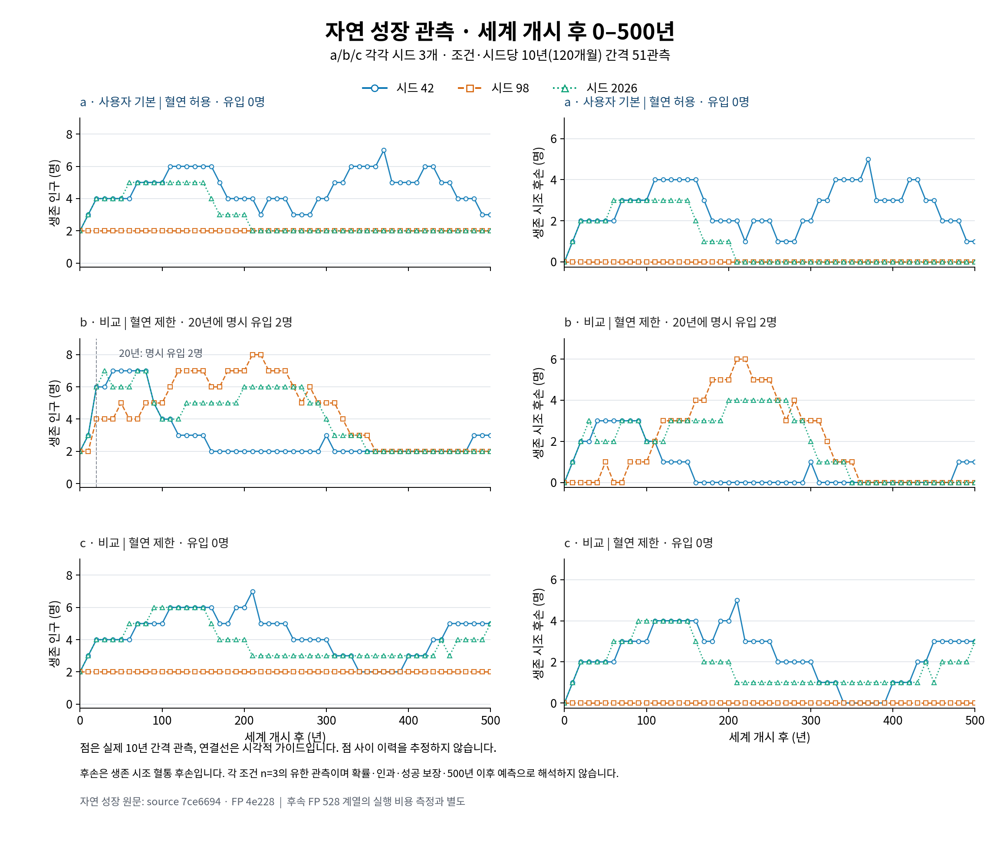
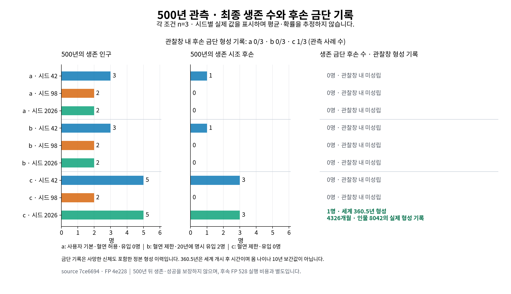

# 자연 성장 9조건의 관측 그림

[원문 9조건](../README.md)의 459개 관측(조건·시드당51개)만 시각화했다. 실측 소스는 `7ce66943b539420c9dc1e3fa8a611daae58020ff`, 제품 지문은 `4e228e7ba34e538fd1a69abf05934d8162b2a65559ed4ffd50a73b00a8ba2304`다. 문서 기준은 `3d86f6c1fd9a2aa8ebb5204b1d6b2273f797b130`이며 후속 FP528 계열의 실행 비용 측정과 구분한다.

## 생존 인구와 생존 시조 후손



[SVG 원본](growth-observations.svg). 점은 세계 개시 후0~500년을10년(120개월) 간격으로 관찰한 값이다. 연결선은 가이드이며 점 사이 이력을 추정하지 않는다. 후손 수는 누적 출생 수가 아닌 **생존 시조 혈통 후손**이다.

| 조건 | 선언한 범위 | 시드 |
| --- | --- | --- |
| a | 사용자 기본, 혈연 허용, 외부 유입0명 | 42/98/2026, n=3 |
| b | 비교용 혈연 제한, 세계20년(240개월)에 자산 없는 범인2명 명시 유입 | 42/98/2026, n=3 |
| c | 비교용 혈연 제한, 외부 유입0명 | 42/98/2026, n=3 |

## 500년의 실제 값과 금단 형성 기록



[SVG 원본](growth-final-outcomes.svg). 각 시드의 최종 생존 인구와 생존 시조 후손을 그대로 표시했다. 관찰창 내 후손 금단 형성 기록은 a0/3·b0/3·c1/3이며 확률 추정이 아니다. 미성립은6000개월 관찰창 내 기록을 뜻한다.

c2026의 첫 후손 금단은 `Cultivation.Formations[GoldenCore].Month`의 실제4326개월, **세계 개시 후360.5년**, 인물8042다. 몸 나이나10년 관측점의 보간값이 아니다. 금단 기록은 사망한 신체도 포함한 정본 형성 이력이며, 그림 오른쪽의 인원 수는500년 시점의 생존 금단 이상 후손 수다.

세 시드의 유한한 기록으로 인과·성공 보장·500년 이후 예측을 주장하지 않는다. 민감도 결과를 넣거나 원문·기본값·원장·게임을 바꾸지 않았다.

## 재현

```bash
python3 -m pip install -r docs/evidence/0.2.1/growth-primary-7ce6694/figures/requirements.txt
python3 docs/evidence/0.2.1/growth-primary-7ce6694/figures/plot-growth.py
```

한글을 지원하는 Noto Sans CJK 또는 Nanum 글꼴이 필요하다. `--font /경로/글꼴.ttf`로 지정할 수 있고 한글 글리프 누락은 오류로 처리한다. 이번 출력은 시스템 Noto CJK로 실제 PNG를 열어 한글을 확인했다. SVG는 글자를 경로로 저장해 공유할 때 글꼴 설치에 의존하지 않는다.

- [observations.csv](observations.csv): 사용한459개 관측의 정수 필드. 시간은 세계 개시 후 값이다.
- [final-outcomes.csv](final-outcomes.csv): 시드별 최종 값과 실제 금단 형성 기록. 미성립의 시각/인물은 빈 값으로 유지했다.
- [figure-provenance.json](figure-provenance.json): 입력9파일의 출처·지문, 글꼴·Matplotlib/Python 버전, 범위와 해석 제한.

재현 스크립트는 기존 JSON을 읽어 그림·파생 CSV/JSON만 만든다. 새 World·성능·성장 실행이나 원문 수정은 하지 않는다.
