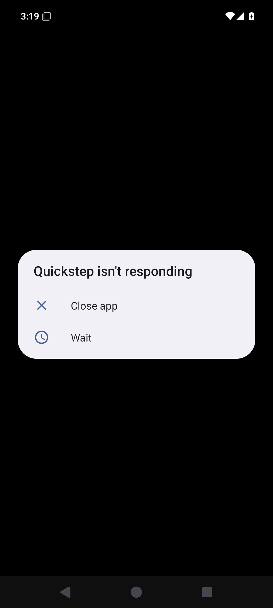
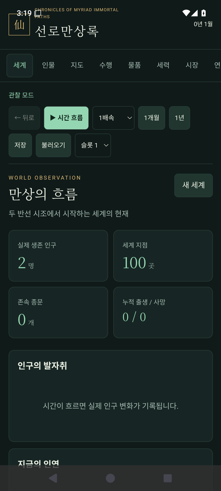

# 기존 CI의 API 24·35 실제 화면과 실행 출처

기존 실행 두 개만 읽었다. 새 CI·앱·Game·기능/성능 실행, 재시도·취소, 제품/기준 변경은 하지 않았다.
실제 결과는 [작은 출처·상태·해시 색인](index.json)에 있다. 기록한 APK 두 개는 서로 다른 CI/서명 맥락이며,
공식 유지 인증서의 **동일 APK를 API 24/35에 설치한 증거나 0.2.0 업그레이드 증거로 승격하지 않는다**.

## 실행 상태와 소스

| 기존 실행 | 실제 상태 |
| --- | --- |
| [API 24: 41163651576](https://github.com/hddy774/project-hora/actions/runs/41163651576) | job 124426500739 성공 |
| [제품: 41163651635](https://github.com/hddy774/project-hora/actions/runs/41163651635) | Android 35 job 124426460326·Windows job 124426460068 성공, portable job 124426460352 취소로 실행 전체는 cancelled |

API 24는 요청 head `6607234b405921cc39e9527cbea42a7667a709be`를 명시적으로 checkout했다.
제품 실행의 실제 checkout은 PR merge `0352a5a0cd298179f613875a7bbcca9dd4632027`이다. GitHub 비교의
변경 파일이 0개이며, 실제 Git commit metadata의 파일 tree도 둘 다
`d0bc3d289210bd0bfbec015d8528e1507a34a635`로 같다. 제품 입력 지문은
`c91c3d7b7cf0441f207825d0490d38501072b63b0364234fbd7cf973b1f620f1`이다. 서로 다른 Git SHA와
같은 파일 tree를 구분하며, 같은 입력 tree에서 APK/인증서까지 같다고 추론하지 않는다.

portable 로그에는 03:23:15.486747UTC에 `The operation was canceled.`가 있다. 내려받은 974B 아티팩트에는
`product-boundary.json`만 있고 전체 기능 보고서는 없다. workflow의 `cancel-in-progress:true`는 새 head가
이전 실행을 취소할 수 있는 구조지만, **이 특정 취소의 원인은 확정하지 않았다**. 전체 기능 합격을 주장하지 않는다.

## API 24 원형 화면

[보존한 최종 PNG](screenshots/api24-final.png) · 원문 150,466B ·
SHA `6c62d1f5668a6f9fe6c37cabad978ea221b4d9afe16e4fc123b02972102484df`

실제 API 24/Android 7.0/x86_64에서 새 설치했고 시스템 WebView 52.0.2743.100의 실제 로딩과 전후 버전
불변을 확인한 producer 원문을 읽었다. `am start -W` 1회·기존 90초 제한 안의31,993.682ms/관측 8회이며
Wait는 0회다. 앱 PID 2678·resumed/currentFocus가 앱이고 화면에 외부 대화상자는 없다.

실제 native DOM은 제목 `선로만상록`, 화면 `만상의 흐름`, version 0.2.1, error:null, connection:`연결됨`이다.
APK producer metadata의 Game/Hosting 버전은 두 개 모두 `0.2.1+6607234b405921cc39e9527cbea42a7667a709be`다.
이 검토에서 큰 APK 자체나 인증서 키를 내려받아 읽지는 않았다.

## API 35: 실제 외부 Quickstep Wait 전후

| 최초 원형: 외부 Quickstep 대화상자 | Wait 1회 뒤 최종 원형: 앱 화면 |
| --- | --- |
|  |  |

최초 PNG는 51,549B/SHA `b32016217f7390bdbd48e27a1e94f779cef5a18379edb48e42e3b8e74932c443`,
최종 PNG는 158,413B/SHA `69c0f2b86e0e52820c7660b3f854a85e722894c0b737b7f171d30faa501b2680`이다.

기존 API 35 x86_64 기본 이미지에서 실제 로드한 WebView는 124.0.6367.219다. 최초 UI/PNG의
`Quickstep isn't responding`과 package `com.android.launcher3`, `android:id/aerr_wait`가 실제 Wait 기록과 같다.
앱 자체나 미확인 ANR을 허용한 것으로 해석하지 않는다. `am start -W`는1회이며 앱 PID 2289는 Wait 전후 같다.

기존 90초 단일 제한 안의11,378.003ms/관측 2회·Wait 1회 후 `wait-after-001`이 최종 자료로 게시됐다.
최종 UI/PNG/window/PID/log는 이 snapshot과 바이트 동일하다. **최종 PNG에는 외부 대화상자가 없고,
스크린샷 뒤 수집한 window의 currentFocus는 앱**이다. activity 자료에도 앱의 topResumedActivity가 있다.
activity 자료의 이른 window-focus 기록과 별도로 최신 post-screen window 자료를 대조했다.

최종 native DOM/브리지는 API 24와 같은 정상 값을 보였다. API 35 XML은 WebView node만 내보내
`accessibility_text_export:false`지만, 원래 검증기가 요구하는 실제 DOM/브리지/전경 기준은 그대로 통과했다.
최종 PNG 두 개는 작성자 Codex와 통합 담당자가 직접 봤다.

API 35 상태 표시줄이 상단 영문 부제 일부와 겹치는 관측도 남긴다. 한글 제목과 주요 명령은 보인다.
원인은 확정하지 않았으며 [낮은 우선순위 후속 #251](https://github.com/hddy774/project-hora/issues/251)에
Insets/상단 안전 영역·API 24 회귀·기존 엄격 기준 유지의 수용 조건을 분리했다. 정본 111개 작업 추가나
현재 제품/성능 입력 변경, 전체 사용성 합격을 뜻하지 않는다.

## 원래 기준·원문 보관 범위

변경 없는 `verify-android-ui.py`에 두 최종 UI/log 원문을 오프라인 재입력해 각각 exit 0을 확인했다.
이는 새 기기/앱 실행이 아니다. 원래 `android_readiness.py`의 앱 생존/전경·90초·이름이 확인된 외부
launcher Wait·자체 앱/미확인 대화상자 거부 기준을 바꾸지 않았다. 기준 파일 SHA는 index에 있다.
Windows는 기존 job stdout의 WPF WebView2 실제 렌더/브리지 성공 JSON을 읽었고, 이 workflow에 없는
Windows PNG나 별도 전경 관측을 수행했다고 주장하지 않는다.

원문 ZIP 709,348B(API 24), 789,566B(API 35), portable 974B의 서버 아티팩트 digest와 내려받은 ZIP SHA가
각각 일치했다. API 24 원문 만료는 2026-11-14, API 35/portable은 2026-11-03으로 index에 기록했다.
전체 ZIP·중복 snapshot·큰 APK·decoded job 로그는 Git에 넣지 않았다. 완전한 원문의 영구 공개 자산 보관으로
주장하지 않는다.

소형 PNG **세 개 합계 360,428B < 5MiB**를 확인한 뒤 통합 담당자의 명시적 추가 승인으로 이 폴더에 원문
그대로 복사했다. 촬영/편집/리사이즈/합성은 0이고 원본 SHA를 유지했다. 나머지는 작은 색인과 해시만 보존한다.
재현 원문 폴더는 `/workspace/scratch/native-6607234-41163651576-41163651635/`이며 정확한 로컬 PNG 경로도
index에 있다. 제품/기획 원장·진행률·work-status는 수정하지 않았다.
