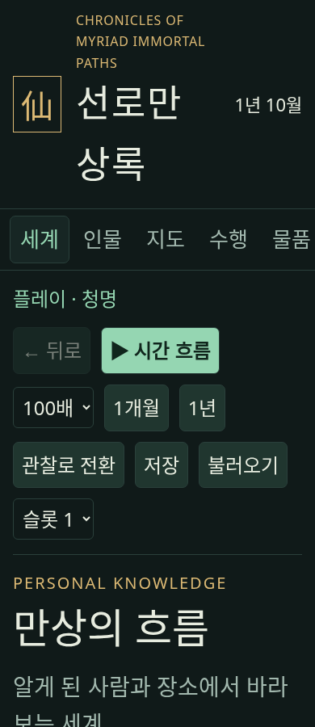
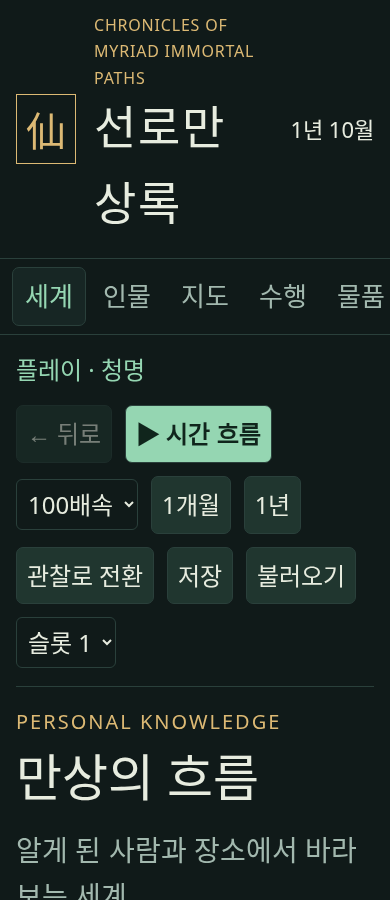

# 작은 화면의 확대 배속 표시 수정과 기능 검수

390px에서 글자를 200%로 키우고 `100배속`을 선택하면 고정 최대 폭 100px 때문에 마지막 글자가 잘렸다. 모바일 선택 상자의 최대 폭을 가용 너비 100%로 바꿔 자연스러운 폭을 허용했다. 선택 폭은 100→122px가 됐고 문서 폭은 390px를 유지했다.

검수한 앱 소스는 `365a5f7d1e96d395a8001509a769f85cd9a3ec78`이다. 새 5223 호스트는 같은 소스의 실제 GameSession을 사용하며 포트·Origin만 분리한 임시 Shell 진입점이다. 기존 5211/5213 호스트를 재사용하지 않았다.

일반 배율과 200%에서 각각 1280/390px의 표준 compat·legacy DOM 전체 기능 회귀를 통과했다. 알려진 수행 경로 명령·저장/불러오기 범위 정리·원자적 법칙 적용·정책·개인 요청·비경과 두 어댑터 응답 재생 검사를 포함한다. 실제 글꼴은 본문 15→30px/14→28px 등 2배이며 DPR은 1이다. 네이티브 재생 검사는 실제 플랫폼 실행 증거와 구분한다.

| 수정 전 | 수정 후 |
| --- | --- |
|  |  |

[출처·방법·한계](ui-text-scale-365a5f7-provenance.json), [일반 기능](ui-text-scale-365a5f7-normal.json), [200% 기능](ui-text-scale-365a5f7-200-functional.json), [실제 폰트 비율·터치](ui-text-scale-365a5f7-200-fonts.json)를 함께 보존했다. 200%는 이번 검수 조건이고 새 정본 최소 조건이 아니다. 최종 T05 수용은 마지막 앱 소스 동결 뒤 별도로 판정한다.
