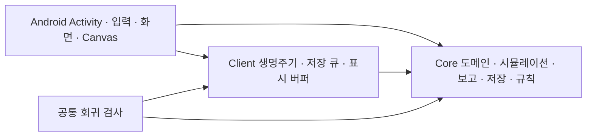

# 코드 구조와 실행 경계

현행 규격은 [개발 규격](development-standard.md), 빌드·서명 절차는 [서명 안내](android-signing.md)에서 관리한다.

프로젝트 경로는 그대로 두고 프로젝트 안의 소유 책임을 나눈다. 여러 게임을 위한 금융 공통 프레임워크를 추가하지 않는다. `AlphaExchange.sln`은 `src`, `tests`, `tools`를 구분하고 실제 사용하는 Debug/Release Any CPU 설정만 제공한다. 모든 C# 프로젝트의 nullable·implicit usings는 `Directory.Build.props`에 한 번 선언한다.

Core의 `Domain`에는 상태 타입과 값 계산을 둔다. `GameState`, `Trader`, `Stock`, `CompanyReport`, 과거 스냅샷은 각 파일에서 선언 순서를 유지한다. 초기 배열 크기 등 공통 값은 `MarketDefaults`를 사용하여 모델이 엔진에 의존하지 않게 한다. `Simulation`의 partial 엔진 파일은 같은 엔진 상태를 소유하며 거래·기관·기업·이벤트 경제 기능별로 배치한다. `Reporting`은 순위와 통계의 계산 원본이다. `Persistence`는 고정 캡처, 트랜잭션 쓰기, 조회, 이관·복구를 구분한다. 상태 10과 SQLite 6을 사용한다. v1.10의 상태 9는 실제 잔액·시간·원본 이력을 보존하며 이관한다. 이전 30종목 파일은 `LegacyArchive`가 원본과 WAL을 변경하지 않고 내보내며 현행 엔진에서 해석하지 않는다.

Android의 `GameView.cs`는 뷰 구성과 세션 연결을 담당한다. `Runtime`은 분 워커·생명주기·저장 요청·파일 선택, `Navigation`은 `ScreenId`와 화면 이동, `Input`은 터치 상태, `Rendering`은 Canvas·이미지·표시 캐시, `Screens`는 기능별 화면이다. UI는 Core의 순위·회계 계산을 복제하지 않는다. 공통 Client 프로젝트를 Android와 검사 프로젝트가 참조하여 같은 코드를 한 번만 컴파일한다.

## 시간·저장 흐름

1. UI 틱은 경과 시간을 `QueueTime`으로 수락한다. Core의 분 워커는 한 분을 처리한 뒤 `simulationGate`를 반환한다. 수락한 대기 시간은 저장되며 임의로 잘라내지 않는다.
2. 저장 요청은 워커에서 `PrepareSave`를 실행한다. 엔진은 이때 잠그고, 저장 워커가 사용할 상태·이력을 고정한다. JSON 인코딩·압축·디스크 쓰기는 이 잠금을 소유하지 않는다.
3. `CheckpointWriter`는 한 쓰기만 실행하고 아직 시작하지 않은 오래된 캡처는 최신 캡처로 합친다. 새 캡처가 미기록 이력을 모두 포함하므로 이력을 버리지 않는다. 실패한 캡처는 재시도까지 보존한다.
4. 초기 불러오기, Activity 일시정지·재생성, 새 시장 전환, 실제 가져오기/내보내기는 프로세스 단위 `AsyncCheckpointBarrier`에 등록한다. 새로운 Activity는 이전 작업의 디스크 완료 뒤에 읽는다. 새 시장은 기존 체크포인트 저장 → 새 엔진 생성 → 최초 저장 → UI 표시 순서로 처리한다.

## 화면 비용과 수명

| 구성 요소 | 한도 | 갱신/해제 기준 |
|---|---|---|
| `ObservationCache` 순위 | 12 조합 | 엔진 상태·완료 분·거래·기업행동·호가 변경, 사용자 작업 후 명시적 Clear |
| `ObservationCache` 호가 | 96 조합 | 위와 동일 |
| `CorporateHistoryCache` | 8 조회 | 상태 교체·새 기업행동; 페이지·회사·조회 개수별 키 |
| 회사 재무 캐시 | 12 조회 | 상태·회사·시즌·기업행동·보고서 개수 |
| 시즌 화면 캐시 | 최대 21 조회 | 새 시장/가져오기 때 Clear; 한도 도달 후 비움 |
| 초상화 아틀라스 | 최대 8개·6 MiB | 파일+샘플 크기로 LRU; 표시 크기·밀도에 맞게 디코딩 |
| 차트 작업 버퍼 | 최대 2,048점 | 한 렌더러에서 재사용; 더 긴 입력은 사전 다운샘플링 |

차트 선·영역 Path와 초상화 Rect·Path를 재사용한다. 로비 그림도 화면 밀도에 맞는 RGB565로 백그라운드에서 읽는다. Activity가 종료되면 그리기 자원과 이미지 캐시 소유권을 해제한다. 표시 목록이 사용할 수 있는 Bitmap을 강제로 recycle하지 않는다. 이미지 예산은 캐시가 소유하는 픽셀 메모리이며 GC·표시 목록·런타임을 포함한 실제 PSS의 상한은 아니다.

일부 기존 기간·시즌·재무 화면의 최초 이력 조회는 아직 동기 경로다. 반복 쿼리는 캐시로 억제하며, [개발 규격](development-standard.md)에 따라 해당 화면을 확장할 때 로딩/실패 상태를 갖춘 비동기 조회로 옮긴다. v1.9의 완전한 UI 스냅샷 분리나 물리 기기 FPS·배터리 검증으로 해석하지 않는다.

검사 코드는 `Client`, `Reporting`, `Simulation`, `Persistence`로 분류한다. 구형 세계·직원·투표 실행 검사는 Git 이력에 보관하고, 현행 시장 회귀와 원본 보관 검사로 대체한다. `scripts/check-architecture.py`는 역방향 프로젝트 의존성, Android 타입의 공통 코드 침투, 도메인의 엔진/저장 의존, 테스트의 앱 소스 링크, Android 동기 대기, 키/빌드 결과의 소스 포함을 차단한다.

## 투자자 전용 구성

`Domain/Companies`는 기업 정책 값·파산 기록, `Domain/Institutions`는 성장·계획·캠페인 상태, `Domain/Economy`는 랜덤 사건 환경을 보관한다. `Simulation/Economy`가 사건·개시 납입·결제 계정을 담당한다. 제거된 World/Governance/직원 계층을 빈 전달 계층으로 유지하지 않는다.

기관의 공개 신호 분석, 전체 목표 비중 계산, 전략 단계, 거래 후보 선택, 위험 청산·주문 가격 계산을 각각 파일로 구분한다. 매 분 공통 시장 신호를 준비하고 기관 판단에는 재사용하는 배열과 고정 크기 임시 버퍼를 사용한다. 계획 설명 문자열은 계획 갱신 때 바꾸고 수치·예약은 매 재평가에 갱신한다.

Android 재무 화면은 통계·포트폴리오·금액 표시·재무표 배치·투자자 재무·기업 분석·위험 보고로 분리한다. 긴 금액은 두 줄 행과 폭에 맞는 글자로 표시한다. 투자자 100명의 10개 아틀라스만 APK에 포함한다.

## v1.11 가격·배분·관측 경계

`DailyPriceLimits`는 전일(또는 이관 시점)의 정확한 기준가와 안쪽 호가 반올림을 소유한다. 캐시는 종목당 한 값이며 기준가가 바뀌면 갱신한다. `PortfolioExposure`는 기관 AI 주문의 주식 하한·현금 목표·대기 매도 예약을 계산한다. 저수준 `SubmitOrder`는 인수·결제·검사에도 쓰이는 가격/시간 우선 매칭 원시 동작이고, AI는 배분 정책을 적용하는 `SubmitInstitutionOrder`를 통한다. 주문 시뿐 아니라 실제 매도 체결 때도 평가 잔액을 재검사한다.

`HourlyLiquidity`는 고정 장기 관심 종목과 순환 담당 종목에 실제 자금·재고를 분산한다. 가격 제한에 걸린 시장에서는 한쪽 주문만 남을 수 있다. `InvestmentOutcomes`는 기관별 포지션 전량 종료를 집계하고 부분 체결을 중복 계산하지 않는다. 부분 단주 정산·합병·자사주 매입·청산으로 기준이 섞인 포지션은 성공 집계에서 제외한다.

공통 가격 신호는 매 분 갱신하되, 변하지 않는 이력 기준·주당 배당금 합계·변동성은 15종목 배열에 보관한다. 상태 객체, 완료 시간, 기업행동 ID가 달라지면 다시 계산한다. 배당수익률의 가격 분모와 현재 가격 추세는 매 분 계산한다. 명시적 신호 분석은 전체 갱신을 지원한다. 같은 시드의 전체 상태 해시와 저장 재개가 달라지면 최적화로 승인하지 않는다.

통계의 성공·비중·호가 참여 계산은 Core Reporting의 기존 통계 캐시를 사용한다. 새 막대그래프·표는 Android에서 최대 15종목/100기관의 집계값을 표시하고 새 이력 SQL 조회를 추가하지 않는다.
