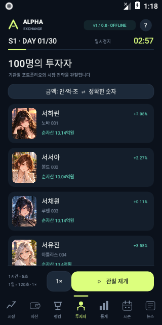
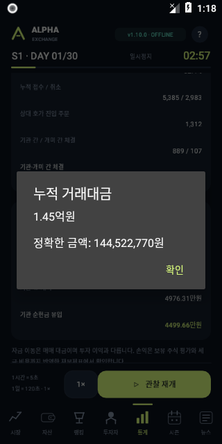
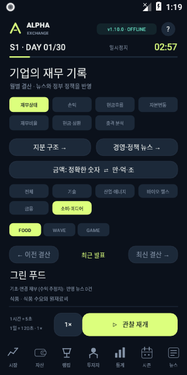
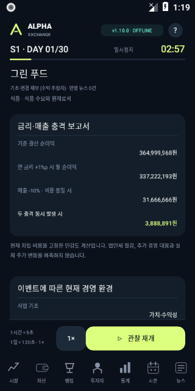

# v1.10.0 검증

현재 코드 `a74d9a1`에서 전체 `scripts/games.py check alpha-exchange`를 통과했다. [원로그](full-verified.log)는 23,679,512개 확인, 16시즌과 저장 재개, 5,430,915회 실제 체결을 포함한다. 현금·실물 주식·예약·대여·기업/투자자 현금흐름·손익·자본, FIFO·자가 체결 금지·원자적 기업행동·백업/복구를 검사한다.

새 시장 검사는 15종목/5업종, 삭제된 인물/투표 모델, 뉴스·추세 반응과 개미의 비공개 정보 미사용, 15종목 공동 예산·집중 한도, 손절/익절, 4단계 기관 전략, 실제 주문과 기관/개미 거래대금, 분 단위 동일 저장 재개, 새 IPO 실제 납입·세대 교체, 구형 DB/WAL 원본 ZIP을 검증한다. 구형 세계 AI·고용·투표 테스트는 제거된 기능의 전제이므로 현행 검사에서 삭제했다.

[5년 합성 저장 검사](storage-load.log)는 43,201개 시간 원기록·경계·백업 내보내기/복원·연속성을 별도로 통과했다. 이는 5년의 경제 시뮬레이션 결과가 아니다. 경제 장기 검사는 위 16시즌이다.

Android Release 빌드는 API 26 이상, ARM64/x86_64, target 34로 성공했다. API 35 툴체인과 target 34 차이 및 기존 Android API 폐기 예정 경고는 남아 있다.

[GitHub Actions 실행 38253948644](https://github.com/hddy774/project-hora/actions/runs/38253948644)의 catalog, 전체 checks, Android 작업이 모두 통과했다. Android 작업은 실제 v1.9.0 Core로 생성한 상태 8/30종목 DB를 설치 경로에 넣은 다음 새 15종목 시장을 시작해 원본 파일 해시가 그대로인 것을 확인했다. 출처와 환경은 [provenance.json](provenance.json), 결과는 [summary.json](summary.json)이다.

- API 26 x86_64 에뮬레이터, 2코어·2GiB·SwiftShader, Wi-Fi/모바일 데이터 비활성화.
- 홈 이동·8초 백그라운드 대기·복귀 시 완료 분/대기 분/소수 진행/거래 ID 불변. [생명주기 원자료](lifecycle.json).
- 논리 높이 480/600/800에서 본문 스크롤, 고정 닫기/확인 버튼, 재열기 초기화, 아래 화면 무반응과 기존 시장 보존. [모달 원자료](modal-viewports.json).
- 투자자 목록·프로필·그림 확대, 금액 축약/정확값 상세, 호가·수급/위험/정책/기관 재무, 5업종 필터와 소비·미디어 3종목/FOOD 선택, 기업 현금/충격 분석을 실제 터치로 확인. 38개 화면 캡처 중 대표 이미지를 보관했다.
- 약 18.47초 측정 구간(입력/확인 경계 허용 2초)에서 100배속으로 20,724게임분 처리, 최종 대기 0. 이 결과를 모든 기기의 처리량·FPS·배터리 보장으로 해석하지 않는다.
- 새 시장 전환 뒤 이전 현행 시장의 20,901 완료 분과 시간별 원기록 364행의 해시 보존. 이전 30종목 DB/백업 파일도 별도 해시로 보존.
- 에뮬레이터 PSS는 192,070~277,346KiB(약 187.6~270.8MiB). APK 크기·관리 할당과 별개이며 물리 기기 메모리 상한이 아니다. 원본 meminfo 파일을 함께 제공한다.

