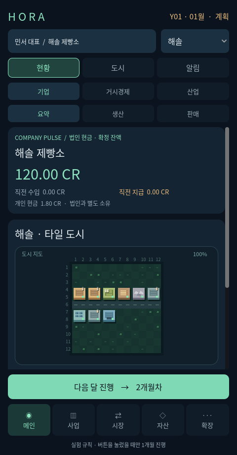

# HORA · 월간 경제 실험실

2026-10-25 사용자 기획서의 **첫 실행 검증 빌드**입니다. 전체 게임 완성본이 아닙니다. 전체 목표와 미구현 항목을 [요구 추적표](docs/requirements.md), [개발 단계](docs/roadmap.md), [미정 사항과 결정 기록](docs/decisions.md)에 남겼습니다. 기존 알파 익스체인지와 별도 프로젝트이며 기존 앱의 저장·서명·릴리스를 변경하지 않습니다.



위 이미지는 구현한 앱의 첫 계획 월을 캡처한 화면입니다.

## 실행하기

Godot **4.6.3 stable**에서 이 폴더의 `project.godot`을 열고 실행합니다. 서버·계정·API 키·네트워크가 필요 없습니다. 처음에는 **새 세계 시작 → 시드 → 세계 생성 및 초기 검사**로 진입합니다.

```bash
godot --path games/monthly-economy
```

별도 Android 실험 APK와 Linux 실행 파일은 저장소의 `monthly-economy/…` 시험판 릴리스에서 제공합니다. Android 패키지는 `org.hora.monthly.experimental`, **디버그 서명**입니다. 알파 익스체인지 업데이트나 정식 배포키로 서명한 출시 APK가 아닙니다. 실기기 호환·배터리·성능 검증은 남아 있습니다.

## 해볼 수 있는 일

1. 메인에서 법인 현금과 개인 현금을 따로 확인하고 도시의 시설을 선택합니다.
2. 사업 → 운영 → 정책에서 생산 목표와 가격 정책을 계획합니다.
3. 사업 → 프로젝트 → 건설에서 시설을 고르고 도로에 접한 빈 타일을 누릅니다. 시작 도시의 `(6,6)`은 빈 부지입니다.
4. 다음 달 진행 → 점검 → 정산을 누릅니다. 실제 급여·생산·거래·생활 소비·공사 결과가 기록됩니다.
5. 월간 보고, 시장의 품목별 수급, 결제 원장과 공사 원인을 확인합니다.
6. 확장 → 게임관리 → 저장에서 수동 저장·로드·타이틀·종료를 사용합니다.

계획과 화면 탐색 중에는 시간이 흐르지 않습니다. 앱을 닫아 둬도 월이 진행되지 않습니다. 한 번의 정산이 한 달이며, 월말에 준공한 시설은 다음 월부터 가동합니다. 사용한 자재와 지급한 공사비는 취소해도 되돌려 생성하지 않습니다.

## 실제 계산과 제한

- 시드가 있는 **3대륙·3국가·3도시, 27기업·81인물·8상품** 검증 데이터입니다. 이 수치는 출시 규모가 아닙니다.
- 유한 재고·소유자 계정·생산 레시피·실제 노동시간과 지급 제약을 사용합니다. 현금·물량 변화는 분개와 이벤트에서 재구성합니다.
- AI의 반복 가격 정책과 플레이어 명령은 같은 권한 검사를 통과합니다. 범용 창업·이직·대표 교체·진입/퇴출 AI는 남아 있습니다.
- 도시 간 매매는 실제 재고와 다음 월 도착으로 연결합니다. 경로·용량·연료·허가·외환·관세는 아직 모델링하지 않았습니다.
- 현재 원장은 **현금 거래와 대응 수익·비용**입니다. 재고원가·건설중자산·발생주의 손익·GDP·중앙은행/은행의 통화 대응부채를 완성한 금융 모델이 아닙니다.
- 전력·용수는 이 단계에서 이월 가능한 단순 투입재로 취급합니다. 실제 전력망·용수망과 기간별 서비스 처리능력은 후속 범위입니다.
- 동일 규격의 개발용 산업을 각 도시에 두었습니다. 대륙 산업 전문화·범용 초기 균형 생성·장기 재생산 검증이 완료된 생성기는 아닙니다.
- 전체 산업, 소프트웨어·라이선스, 신용·주식·보험, 국가/도시 정치·외교·군수 조달은 [추적표](docs/requirements.md)에 미구현으로 보존합니다.

화면의 현금·품목별 재고·거래 기록은 실제 계산값입니다. 단위가 다른 물량 합계를 GDP나 총생산량으로 표시하지 않습니다. 모형의 장기 안정성이나 현실 경제 재현을 주장하지 않습니다.

## 검증과 빌드

```bash
godot --headless --path games/monthly-economy --editor --import --quit
godot --headless --path games/monthly-economy --script res://tests/run.gd
godot --headless --path games/monthly-economy --script res://tests/test_ui.gd
godot --headless --path games/monthly-economy --script res://tests/test_game_flow.gd
godot --headless --path games/monthly-economy --script res://tools/simulate.gd -- --months=3 --seed=42
cd games/monthly-economy
bash tools/install_godot.sh
bash tools/build.sh all
```

Android 내보내기는 Java 21, Android SDK와 Godot export templates를 사용합니다. `tools/configure_android.py`가 표준 SDK 환경을 검사합니다. 바이너리 체크섬·앱 ID·권한·ABI·인증서 검증 결과는 `build/`에 기록합니다. 저장은 `user://saves`의 검사된 스냅샷과 이전 정상 백업을 사용합니다. 전원 차단·디스크 장애의 모든 조건에 대한 내구성 보장은 아닙니다.

CI는 기존 서명 자동화와 분리된 [monthly-economy.yml](../../.github/workflows/monthly-economy.yml)입니다. 세부 결과와 미검증 범위는 [검증 기록](docs/validation.md)을 참고하세요.

## 구조와 라이선스

`core/`는 UI와 분리된 명령·회계·재고·월 정산·저장, `ui/`는 조회·입력·자체 도형 지도, `tests/`는 경제 불변식·복구·UI 여정 검사를 담당합니다. 그래픽 프레임이나 카메라가 경제 시드에 영향을 주지 않습니다.

지도와 아이콘은 자체 제작 도형입니다. Noto Sans KR 글꼴은 SIL OFL 1.1([고지](assets/FONT-LICENSE.txt)), Godot 엔진은 MIT([고지](https://godotengine.org/license/))입니다. 프로젝트 코드의 별도 오픈소스 라이선스는 사용자가 아직 선택하지 않았습니다. 공개 저장소라는 이유만으로 MIT 등의 라이선스를 임의 부여하지 않습니다. 참고작 공식 출처와 사용자 제공 조사/이번 구현 검증의 경계는 [references.md](docs/references.md)에 기록했습니다.
