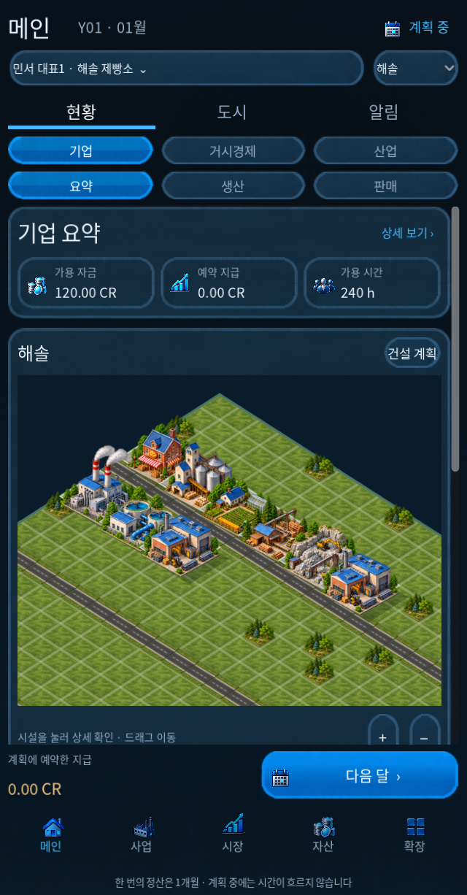

# Hora Economic Lab · 호라경제연구실

**한 달의 결정으로 사람·기업·도시와 세계 경제를 움직이는 오프라인 경제 시뮬레이션 게임입니다.** 플레이어는 세계 안의 인물 한 명으로 일하고, 회사를 세우고, 투자·경영·정치 활동을 선택합니다. 개인 자금과 회사·정부의 자금은 따로 관리합니다.

세로 화면에 **메인 · 사업 · 시장 · 자산 · 확장** 다섯 탭을 두고, 그 위의 **다음 달** 버튼으로만 시간을 진행합니다. 앱을 닫거나 기다려도 달이 지나가지 않습니다. 화면의 날짜·장부·공사·그래프는 실제 시뮬레이션 결과입니다.



## 다운로드와 실행

[최신 릴리스](https://github.com/hddy774/project-hora/releases/latest)에서 Android APK와 Linux 실행 파일, 체크섬·빌드 검증 기록을 제공합니다. 각 릴리스의 실제 제공 파일과 검증 범위를 확인하세요. 새 앱 ID는 `org.hora.economiclab`입니다. 기존 실험 앱과 알파 익스체인지의 저장은 별개이며, 저장 형식이 맞지 않는 원본은 보존합니다.

Godot **4.6.3 stable**로 이 폴더의 `project.godot`을 열거나 저장소 루트에서 실행할 수 있습니다.

```bash
godot --path games/monthly-economy
```

서버·계정·API 키가 필요하지 않습니다. 새 게임에서 시드·세계 규모·시작 인물을 선택합니다. 연습 세계는 일반 플레이와 별도 저장으로 사용합니다.

## 플레이할 수 있는 시스템

- **실제 공급망:** 농림축수산·광물·에너지·소재·부품·소비재·자본재와 서비스, 다중 투입·부산물·자원 고갈·생장·부패·재활용을 계산합니다. 전력과 용수는 월별 제공 능력을 사용합니다.
- **타일 건설:** 도로·점유·부지, 실제 자재·시공 인력·장비시간·지급·최소 공기를 검사합니다. 공사 중단·재개·취소와 준공 다음 월 가동을 구분합니다.
- **인물과 회사:** 구직·채용 동의·계약 보장 임금과 체불·교육·이주·창업·대표 지원/임면·지분·권한 위임·자회사·인수·청산을 다룹니다. AI와 플레이어는 같은 명령 검증을 사용합니다.
- **시장과 국제 거래:** 실제 재고·주문·화물·운송업자·연료·노동·납기, 관세·제재·외환 상대방을 기록합니다. 도시 내부와 국경 간 교역을 구분해 집계합니다.
- **연구와 디지털 사업:** 연구·설비 도입, 개발·시험·출시, 소프트웨어 사용권·호환 플랫폼·구독·서버 처리능력을 연결합니다.
- **금융:** 은행 예금·대응 부채·결제자산, 대출·원금·이자·연체, 주식 발행과 유통 거래, 채권·보험·유한 외환을 관리합니다.
- **정치와 군수:** 도시/국가 공직·정당·선거·정책 승인/발효·세금·예산·조약, 군 보급·비축과 공고→입찰→납품→검수→지급을 연결합니다.
- **설명과 저장:** 원인 사건·거래 원장·부가가치와 품목별 통계, 월 보고·설정·도움말·정상 이전본 복구를 제공합니다.

현재 기본 데이터는 **정확히 3개 대륙·3개 국가·6개 도시, 124개 기업·378명·82개 상품**의 실험 구성입니다. 작은 연습 세계도 선택할 수 있습니다. 대륙 3개만 사용자 확정 조건이며 나머지 수치와 가격·임금·공기·법률 계수는 버전이 있는 `experimental` 데이터입니다.

## 실제 검증과 전체 목표

이번 구현은 전체 산업과 인물·금융·공공 모듈을 연결한 개발 릴리스입니다. 전체 기획의 모든 제도·품목·장기 균형·실기기 품질이 완료됐다는 뜻으로 최신 릴리스 표시를 사용하지 않습니다. 상세 구현 경로와 남은 심도, 실행한 시험은 다음 문서에서 확인할 수 있습니다.

- [요구 추적표](docs/requirements.md)
- [검증 결과와 한계](docs/validation.md)
- [결정·실험 수치](docs/decisions.md)
- [관찰에서 보강한 개시 배치·임금 규칙](docs/economy-balancing.md)
- [전체 개발 범위](docs/roadmap.md)

장부·재고·시간·권한 불변식과 같은 시드/명령의 재현성을 검사합니다. 불황·품귀·기업 파산은 허용되는 경제 결과이며, 게임 도중 AI에게 무료 자금이나 재고를 넣어 숨기지 않습니다. 고정 기준가격의 실제 부가가치와 현금 흐름을 구별하고, 단위가 다른 물량을 합해 GDP로 표시하지 않습니다.

```bash
godot --headless --path games/monthly-economy --script res://tests/run.gd
godot --headless --path games/monthly-economy --script res://tests/test_ui.gd
godot --headless --path games/monthly-economy --script res://tests/test_ui_forms.gd
godot --headless --path games/monthly-economy --script res://tests/test_game_flow.gd
cd games/monthly-economy
bash tools/build.sh all
```

Android 빌드는 Java 21·Godot export templates·Android SDK build-tools **36.0.0**을 사용합니다. 소스 검증과 unsigned release APK 생성 이후, GitHub의 별도 게시 단계가 보관된 저장소 배포 인증서로 서명하고 업로드한 파일을 다시 내려받아 검사합니다. 로컬 실행 시험용 인증서는 공식 릴리스에 사용하지 않습니다.

## 이미지와 라이선스

UI 스킨·아이콘·조작 이미지·도시 건물·지형·앱 아이콘은 이 게임을 위해 생성하여 실제 텍스처 리소스로 사용합니다. [생성 리소스 명세](assets/generated/provenance.json)에 생성 ID와 SHA-256을 기록했습니다. 이미지에 숫자나 버튼 글자를 굳혀 넣지 않고 실행 중 데이터와 접근 가능한 텍스트를 표시합니다.

Noto Sans KR은 SIL OFL 1.1([고지](assets/FONT-LICENSE.txt)), Godot은 MIT 및 포함된 제3자 라이선스([고지](assets/GODOT-NOTICES.txt))를 따릅니다. 프로젝트 코드의 별도 배포 라이선스는 임의로 부여하지 않았습니다. 참고작 공식 출처와 독자 설계는 [조사 기록](docs/references.md)에 구분했습니다.
