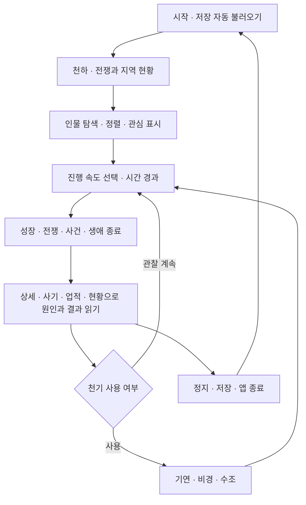

# 01. 게임 기획서

> 0.1.0 작성 시점의 설계·검토 기록입니다. 0.2.0 구현과 달라진 사항은 [현재 구현 기준20](20-v0.2.0-implementation.md)과 [실측19](19-balance-v0.2.0.md)를 우선합니다.

상태: 현재 구현을 복원한 검토 초안. 기준과 상태 표기는 [문서 홈](README.md)을 따른다.

## 1. 제품 개요

**선로만상록 프로젝트**은 수선자 1,000명의 수행·종문 경쟁·생애·윤회를 빠르게 흘려보내면서 흥미로운 인물과
사건을 찾아 읽는 한국어 오프라인 싱글플레이 관찰 시뮬레이션이다. 주 플랫폼은 세로 화면 Android다.
동일한 Avalonia 화면과 C# 규칙을 사용하는 데스크톱 실행 프로젝트도 있다.

| 항목 | 현재 구현 |
|---|---|
| 플레이어 역할 | 수선자를 직접 조종하지 않는 관찰자. 관심 표시와 제한된 천기 개입 가능 |
| 시간 | 1틱=세계의 1년. 화면의 실제 초와 구분 |
| 기본 세계 | 시드 20261028, 인구 1,000명, 청운종·천마문·산수, 지역 13개 |
| 생성 범위 | 설정에서 시드와 인구 100~3,000명을 지정 |
| 주 콘텐츠 | 경지 9개 × 단계 4개, 공법 20등급 정의, 법보·기예·단약·부적, 전쟁·대비무·비경·수조·경매 |
| 진행 속도 | 1 / 5 / 20 / 100 / 500년/초, 최대 속도. 기본 선택은 20년/초 |
| 저장 | 기기 내부 자동·수동 저장과 불러오기, 앱 백그라운드 시 저장 |
| 온라인 요소 | 계정·서버·멀티플레이·동기화 구현 없음. Android 인터넷 권한 없음 |
| 종료 조건 | 게임 전체의 승리·패배·최종 엔딩 없음. 개별 수선자는 비승하거나 윤회 |
| 수익화·연령 등급 | 광고·결제 구현 없음. 사업 모델과 공식 이용 등급은 미결정 |

공법 20등급이 정의되어 있다는 사실과 20등급 모두를 플레이 중 얻을 수 있다는 주장은 다르다.
신품 공법의 도달 경로는 [검토 항목 OQ-04](12-open-questions.md)에 남겼다.

## 2. 핵심 경험과 기획 해석

구현을 통해 읽히는 핵심 경험은 세 가지다. 이를 정식 제품 기둥으로 채택할지는 오너의 결정이 필요하다.

| 기획 해석 | 구현 근거 | 확인할 질문 |
|---|---|---|
| 인물을 고르고 오래 지켜본다 | 관심 표시, 인물 상세, 생애·전생·호칭, 주요 사건 알림 | 유저가 왜 이 인물을 선택하는지 충분한가? |
| 개인의 성장이 천하의 역사가 된다 | 종주 교체, 전쟁 영웅, 대회 우승, 최초 경지·비승 기록 | 기록의 연결만으로 서사가 읽히는가? |
| 조금 개입하고 결과를 관찰한다 | 천기 2~3점 개입, 200년마다 회복 | 개입 결과가 이해되고 반복 관찰할 이유가 생기는가? |

관심 표시는 비개입 관찰처럼 보이지만 로그 난수 호출을 통해 이후 세계 결과가 달라지는 실험이 있다.
기획상 허용할지, 관찰·알림과 세계 난수를 분리할지는 [OQ-01](12-open-questions.md)의 결정 사항이다.

## 3. 플레이 흐름

현재 앱은 실행 후 자동으로 진행한다. 정지 버튼으로 멈춰 상세 기록을 읽을 수 있다.
백그라운드에서 실제 경과한 시간만큼 세계를 따라잡는 오프라인 보상은 구현하지 않았다.

### 첫 플레이

1. 천하 화면에서 양 종문의 기풍과 현재 전쟁·휴전 상태를 읽는다.
2. 인물에서 재능·경지·전투력 등으로 후보를 찾고 상세 화면에서 관심 표시를 한다.
3. 성장과 대회가 나타날 때까지 진행하고 사건 알림 또는 사기에서 인물을 다시 연다.
4. 천기를 써서 한 인물을 돕거나 지역 사건을 열고 결과를 관찰한다.
5. 설정에서 저장한다. 새 세계는 확인란을 선택해야 시작할 수 있다.

이 흐름을 설명하는 도감은 있으나 단계별 온보딩·추천 인물·초기 목표 미션은 구현하지 않았다.

## 4. 시간과 주요 이정표

| 세계 연도·주기 | 동작 |
|---|---|
| 0년 | 두 종문·산수 생성, 종문별 개창 원로 13명까지 설정, 첫 통계 표본 |
| 50년마다 | 산수 입문 시험 |
| 100년마다 | 종문 정산·단약 공급·배신 검사, 기록 갱신·숙적 정리 |
| 150년 이후 300년마다 | 중원 경매 |
| 300년마다 | 종문 직위 재편 |
| 500년 | 첫 천하 대비무가 가능한 시점. 전쟁 전에도 열린다 |
| 3,000~3,999년 | 첫 정마대전 |
| 4,000년 | 첫 종전. 이후 10,000년 휴전 |
| 이후 11,000년 주기 | 1,000년 전쟁과 10,000년 휴전 반복 |
| 200년마다 | 천기 1점 회복, 상한 10점 |
| 3,000~8,000년 길이 | 시대가 교체됨. 평온 이외의 같은 시대 연속 선택은 제외 |

수행 속도는 실제 선택한 행동과 자원·관계·시대에 따라 달라진다. 경지 진급 시간을 고정 약속하지 않는다.

## 5. 인물과 성장의 구조

수선자 한 명은 영혼 ID를 유지하며 여러 생을 산다. 현생에는 경지·공법·기예·영석·인연·호칭·생애 기록이
있다. 자연 좌화나 경지 붕괴 후에는 같은 영혼이 16세 상태로 새 생을 시작한다. 비승하면 해당 영혼은
명부에 남고 같은 인구 슬롯에 새 영혼을 만든다. 따라서 살아 있는 인구는 설정한 수를 유지한다.

재능은 오성·체질·근골·영근의 네 값이다. 오성은 깨달음·돌파, 체질은 수명·체력·천겁, 근골은 전투력,
영근 능력치는 수련 속도에 영향을 준다. 금·목·수·화·토와 뇌·빙·풍이라는 **영근 속성**은 별도 필드다.
재능 총합과 속성의 이름을 같은 의미로 혼용하지 않아야 한다.

일부 고수가 오래 살아 경지 피라미드의 상층을 이루도록 요구 영기가 수명보다 빠르게 증가한다.
이는 계산식과 코드 주석에서 복원한 방향이며, 실제 도달 빈도에 대한 제품 목표는 아직 수치로 승인되지 않았다.

## 6. 종문과 세계

- **청운종**: 정도. 높은 경지 성장과 안정적인 돌파에 유리한 보정이 있다.
- **천마문**: 마도. 낮은 경지에서 빠르고 전쟁·약탈에 유리한 보정이 있다.
- **산수**: 떠돌이. 종문 직위·녹봉·공헌 교환이 없고 탐색·거래·이동으로 자원을 얻는다.
- **지역**: 본산·영지와 접경지로 구분한다. 영기·영초·영철·위험도와 거주자 목록이 있다.
- **정마대전**: 접경지 지배·승수·종전 대표 결투가 승패를 정한다. 영석 배상과 영웅 기록이 남는다.
- **천하 대비무**: 휴전 중 고수를 선발하는 토너먼트. 대진표·우승·이변과 상금을 기록한다.
- **비경·수조·경매·시대**: 성장 자원과 위험, 세계 변화의 계기를 제공한다.

지도 선과 배치는 개략도다. 실제 이동 거리·경로 탐색·행군 시간·격자 영토·도시 건설은 구현하지 않았다.

## 7. 관찰자 개입

| 개입 | 비용 | 효과 |
|---|---:|---|
| 기연 하사 | 천기 2 | 깨달음 +400, 현재 필요 영기의 50% 추가, 부상·요양 해제, 도심 +20, 천명 호칭 |
| 비경 개방 | 천기 3 | 선택 지역에 비경 생성 |
| 수조 소환 | 천기 3 | 선택 지역에 영수 떼 습격 생성 |

UI는 같은 지역의 같은 종류 사건 중복을 막는다. 코어 API와 자연 발생은 별도의 중복 제한을 두지 않으므로
이를 세계 전체의 강제 불변식으로 설명해서는 안 된다. 개입은 해 사이에 실행기 잠금을 잡고 반영한다.

## 8. 장기 목표와 보상

구현된 장기 보상은 경지 상승, 종주·영웅·대회 성적, 호칭, 세계 최초 기록, 생애 최고 점수,
상위 5생 점수 합, 비승 명부다. 플레이어 계정 레벨·재화·영구 능력치·도전과제 해금 보상은 없다.

현재 종합 업적 순위는 최고 점수 순위와 5생 합 순위의 합이 작을수록 높다. 현생의 미확정 점수는
종료한 생의 업적 순위에 합치지 않는다. 1~100, 101~300, 301~500, 501~700, 701위 이하 구간을 표시한다.

## 9. 현재 범위와 미결정 기획

| 영역 | 현재 상태 | 결정 필요 |
|---|---|---|
| 관찰의 재미 | 자료 탐색·알림·개입이 구현됨 | 추천 관찰 대상, 목표, 요약과 인과 설명의 깊이 |
| 패배·죽음 | 부상과 경지 하락, 수명·붕괴 좌화 | 전투 즉사·영혼 소멸을 추가할지 |
| 종문 경쟁 | 두 고정 종문과 지배 접경지 | 종문 신설·멸망·외교·동맹의 필요 여부 |
| 경제 | 영석 장부와 추상적 상회·시장 | 거래량·물가·실물 보존을 시뮬레이션할지 |
| 관계 | 스승·제자·도려·숙적 | 관계 서사·가족·성별·자손 규칙의 필요 여부 |
| 세계·콘텐츠 | 13개 고정 지역과 절차적 이름 | 추가 지역, 이벤트 다양성, 엔드게임 빈도 목표 |
| 세션 | 한 세계·한 저장 슬롯 | 다중 슬롯·수동 백업·내보내기·자동 세대 백업 |
| 운영 | APK 직접 배포 | 배포 채널·지원 기기·실기기 출시 수용 기준 |

후속 계획은 [09](09-requirements-and-roadmap.md)에 제안으로 분리한다. 위 항목은 이번 버전에 이미
있다고 소개하지 않는다.

## 10. 대상·서사·콘텐츠 운영의 기획 가설

예상 독자는 한국어 선협 용어와 인물 성장·통계·절차적 사건을 읽는 재미를 선호하는 관찰 시뮬레이션
이용자다. 이것은 구현에서 복원한 타깃 가설이며 사용자 조사·시장 검증 결과는 없다.
짧게는 한 인물의 성장과 한 사건을 확인하고, 길게는 여러 생과 종문 흥망을 비교하는 사용을 가정한다.
실제 권장 세션 길이·첫 보상 시간은 아직 정하지 않았다.

서사는 수치와 시스템 사건을 한국어 템플릿으로 설명하는 방식이다. 인물 이름·도호·비경 이름은 음절
표와 난수로 만든다. 고정 주인공·메인 퀘스트·수작업 장편 시나리오·대화 선택지는 없다.
정도/마도는 게임 규칙상의 이념이며 두 종문의 성장·전투·행동 보정을 설명하는 장치다.
전투·좌화는 수치와 문장으로 표현하며 연출·음향 콘텐츠의 추가 범위는 정해지지 않았다.

신규 콘텐츠는 이름과 설명뿐 아니라 발생 조건, 비용·보상·실패, 기록·알림·링크, 저장 상태,
난수 호출, 장기 빈도와 UI 가독성을 함께 정해야 한다. 호칭·공법·지역의 현재 전체 정의는
[03](03-balance-and-content.md)에 있다. 새로 정의한 등급이 실제 획득 가능한지도 확인해야 한다.

관찰 재미의 검증 지표로는 첫 관심 인물 선택까지의 시간, 사건 뒤 원인을 설명할 수 있는 비율,
같은 영혼을 재방문하는 행동, 저장·복귀 이해도 등을 제안한다. 앱에는 이용 분석 수집이 없으므로
이 지표는 동의받은 사용성 관찰로 확인할 후보이며 현재 계측된 KPI가 아니다.

## 11. 근거

- [WorldFactory](../src/Xianxia.Simulation/Systems/WorldFactory.cs), [Balance](../src/Xianxia.Simulation/Data/Balance.cs)
- [WorldSimulator](../src/Xianxia.Simulation/WorldSimulator.cs), [World 모델](../src/Xianxia.Simulation/Model/World.cs)
- [MainView](../src/Xianxia.App/Views/MainView.cs), [GameSession](../src/Xianxia.App/Services/GameSession.cs)
- [호칭·세계 기록](../src/Xianxia.Simulation/Systems/RecordSystem.cs), [천기 개입](../src/Xianxia.Simulation/Systems/InterventionSystem.cs)
