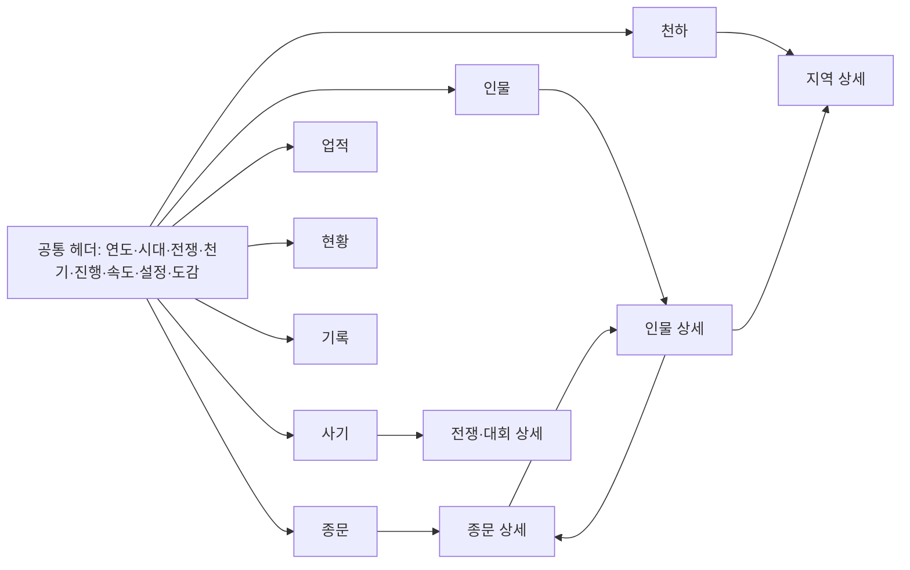

# 04. 화면·조작 명세

상태: 기준 소스의 구현 명세. 실제 Android 검증 범위는 [08](08-validation.md)과 구분한다.

## 1. 화면 구조와 이동

세로 화면에 공통 헤더, 선택한 본문, 하단 일곱 탭을 배치한다. 본문 위에는 알림 층, 그 위에는 상세 시트
층이 있다. 기본 선택은 **천하**다. 탭과 주요 컨트롤은 한 번 만들고 재사용하며, 250ms 타이머가 실행기
버전 또는 UI 무효화 상태를 확인해 현재 탭과 열린 시트를 갱신한다. 세계의 해상도와 UI 갱신 주기는 다르다.

상세는 `SheetLink(종류, ID)`로 연다. 링크는 수선자 영혼 ID, 종문 ID, 지역 ID 또는 대회·전쟁 번호를
사용한다. 상세에서 다른 상세를 열면 스택에 쌓는다. Android 뒤로 가기는 열린 시트를 하나 닫고,
시트가 없고 다른 탭이면 천하로 돌아간 뒤, 천하에서 플랫폼에 종료 처리를 넘긴다. 정적 웹 URL·딥링크는 없다.

## 2. 공통 헤더

| 요소 | 표시·동작 |
|---|---|
| 제목·연도 | 선로만상록 프로젝트, 현재 세계 연도 |
| 세계 상태 | 시대, 전쟁·휴전, 천기 잔량 |
| 진행 | 진행/정지. 상세를 여는 것만으로 자동 정지하지 않는다 |
| 속도 | 1·5·20·100·500년/초·최대. 기본 20년/초, 실제 처리 속도는 기기 성능에 따라 다름 |
| 설정 | 저장·불러오기·새 세계 시트 |
| 도감 | 관찰 방법과 실제 규칙표를 보여 주는 도움말 |

최대 속도는 특정 년/초를 보장하는 값이 아니다. 재개할 때 실제 경과 시간 전체를 따라잡지 않는다.

## 3. 일곱 본문

| 탭 | 정보와 주요 조작 | 연결 대상 |
|---|---|---|
| 천하 | 시대·전쟁 요약, 지역 개략도, 진행 중 사건, 주요 인물 | 지역·종문·인물·전쟁 |
| 종문 | 청운종·천마문 선택, 기풍·금고·영지·직위·시설·강자 | 종문·인물·지역 |
| 인물 | 이름 검색, 소속·관심 필터, 여덟 정렬, 페이지 탐색 | 인물 |
| 사기 | 연대기·천하 기록·전쟁·대회·비승·경매의 여섯 분류 | 사건 관련 인물·종문·지역·전쟁·대회 |
| 업적 | 최고 생애·5생 합·종합·호칭의 네 분류, 순위 구간 | 인물 |
| 현황 | 경지·소속 분포와 시계열, 사건 누계 등 통계 | 읽기 중심 |
| 기록 | 최신 사건과 종류별 누계, 종류·관심 인물 필터 | 사건 관련 인물·종문·지역 |

### 인물 탐색

- 이름에 대해 앞뒤 공백을 제거한 `OrdinalIgnoreCase` 부분 문자열 검색을 한다.
- 소속 필터는 전체·청운종·천마문·산수·관심이다. 관심은 복수 지정할 수 있다.
- 정렬은 경지, 전투력, 나이, 재능 총합, 승수, 영석, 윤회 횟수, 현생 업적 점수 내림차순이다.
  경지 키는 `Realm*4+Stage`다. 동점은 영혼 ID 오름차순이다.
- 한 페이지 20명이다. 필터·검색은 세계를 바꾸지 않는다. 관심 변경은 저장되는 세계 입력이며
  이후 난수 결과에 영향을 주는 현상은 [OQ-01](12-open-questions.md)에서 별도로 검토한다.

### 기록과 업적의 읽는 법

사기·업적의 주요 목록은 20개 단위, 사건 기록은 40개 단위다. 기록은 최신 600건만 탐색 가능하고
누계는 그보다 오래된 사건도 포함한다. 전투 하나마다 전체 로그 한 줄이 남는 구조가 아니므로
목록 길이와 총 전투 수를 동일시하지 않는다. 업적 종합 순위는 두 순위의 합을 쓰며 [02](02-simulation-rules.md)를 따른다.

## 4. 상세 시트 일곱 종류

| 종류 | 하위 화면·필드 | 입력 |
|---|---|---|
| 인물 | 개요·전투력·수행·소지·인연·생애·윤회. 경지·영기·수명·기예·도심·공법·법보·단약·호칭 등 | 관심 토글, 천기 2점 기연, 소속·지역·관계 인물 이동 |
| 종문 | 정보·강자·공헌·시설·역사 | 강자/공헌 순 목록에서 인물 이동 |
| 지역 | 정보·시장·거주자 | 천기 3점 비경/수조, 거주자 인물 이동 |
| 전쟁 | 진행 중 또는 종료 기록, 전적·영지·대표 결투·배상·영웅·주요 장면 | 관련 인물·종문·지역 이동 |
| 대회 | 대회 요약·우승자·대진·모든 보존 경기·이변 | 20경기씩 이동, 참가자 상세 |
| 설정 | 현 세계·저장 상태, 시드·인구 입력, 새 세계·불러오기 확인 | 저장·불러오기·새 세계 |
| 도감 | 관찰·저장 조작과 경지·시설·호칭 등 설명 | 읽기 중심 |

종문 공헌 목록은 소비 가능한 `ContributionPoints` 순이며 누적 `Merit` 순이 아니다.
지역 거주자는 경지·단계 내림차순, ID 오름차순이다. 대회 한 경기는 참가자 두 줄로 표시하므로
20경기가 40개 참가자 행에 해당한다. 남은 경기 전체에 페이지로 접근할 수 있다.

영혼이 비승해 현재 인구에서 사라졌거나 기록 대상이 없으면 빈 상태 안내를 표시한다. 과거 링크를
다른 영혼에게 재할당하지 않는다. 윤회한 같은 영혼은 현생 상세와 보존된 전생 요약을 함께 보여 준다.

## 5. 설정과 파괴적인 입력의 UX

수동 저장은 현재 세계를 기존 슬롯에 기록한다. 불러오기는 현재 진행을 버리고 마지막 저장으로 교체한다.
새 세계는 시드·인구를 검증하고 현재 슬롯을 대체한다. 불러오기와 새 세계는 명시적 확인란이 필요하다.
새 세계를 만들면 즉시 저장한다. 여러 저장 슬롯이나 사용자 파일 선택기는 구현하지 않았다.

| 입력 | 현재 검증 |
|---|---|
| 시드 | 부호 없는 64비트 정수, 지정 파싱 규칙으로 변환 가능해야 함 |
| 인구 | 정수 100~3,000 |
| 확인 | 확인란을 선택하기 전 실행하지 않음 |
| 작업 중 | 중복 작업 방지, 실행 상태와 결과 메시지 표시 |
| 실행 | 수동 파일 작업·새 세계 생성은 비동기 작업으로 보내고 실행기를 정지시킴 |

앱 시작 시 자동 불러오기는 이 설정 작업 경로와 다르다. 시작 로드는 동기식이며 큰 저장 파일의
첫 화면 지연은 아직 측정하지 않았다. 저장 실패 시 파일 작업의 오류를 안내하지만 모든 형식·메모리
예외를 UI에서 복구하는 계약은 없다.

## 6. 알림과 표시 규칙

주요 연대기 및 관심 인물의 주요 사건을 일시적 토스트로 표시한다. 세계 내 대기열은 최신 40개,
화면에는 최대 3개, 각 표시는 약 5초다. 대상 링크가 있으면 상세를 연다. 대기열은 저장하지 않는다.
상세 시트가 알림보다 위에 있다. 현재 `MainView`는 시트가 열려 있어도 토스트 갱신을 활성화한다.
별도 알림 설정·음향·진동·영구 알림함은 없다. 중요한 기록의 영구 보관은 사기·인물 기록 범위에 의존한다.

숫자·한글 이름은 공통 `Fmt`·`Labels`를 사용한다. 막대는 실제 값의 비율을 표현하고,
전투력·돌파 확률은 코어 계산을 읽는다. UI에서 독립적인 게임 수식을 만들지 않는다.

## 7. 시각 시스템과 자산

| 토큰 | 값 | 용도 |
|---|---|---|
| Parchment | `#F5EDE0` | 전체 양피지 배경 |
| HeaderBack / PanelBack / CardBack | `#E8D8B8` / `#EDE3CC` / `#E4D8BC` | 헤더·패널·카드 |
| Ink / Muted | `#1E0E00` / `#8A6840` | 본문·보조 글자 |
| Accent / OnAccent | `#7A4800` / `#FDF0D8` | 선택·실행 버튼 |
| Orthodox / Demonic / Rogue | `#1155AA` / `#CC4444` / `#7F7F7F` | 세력 |
| War / Peace | `#CC6600` / `#228855` | 전쟁·휴전 |
| Danger / Favor | `#B03A1A` / `#5A3FA0` | 위험·천기 |

경지 9종·속성 8종·재능 5등급·로그 19종·연대기 15종에도 색을 배정한다. 정확한 색은
[Palette](../src/Xianxia.App/Theme/Palette.cs)가 기준이다. 문구와 색을 함께 사용하지만
색각·명도 대비·스크린리더·키보드 탐색은 별도 접근성 검증을 통과한 상태가 아니다.

기본 글꼴은 내장 **Noto Serif KR** Regular/Bold 부분집합이다. 폰트 라이선스는 OFL이며
KS 완성형 2,350자·ASCII·소스에 사용한 추가 글자를 포함하도록 생성한다. 새 문구에 대한 글리프
완전성을 자동 보장하지 않으므로 콘텐츠 변경 후 재생성과 렌더 검사가 필요하다.
버튼 기본 12, 작은 칩 11, 카드 13 논리 단위를 사용한다. Android의 물리 픽셀과 같지 않다.

## 8. 크기·접근성·관찰 UX 검토

화면은 Avalonia의 safe-area 자동 패딩을 끄고 InsetsManager 값을 본문과 시트에 수동 반영한다.
Android는 세로 고정이다. 360폭과 412×860 헤드리스 검사는 렌더 경로의 회귀 확인이며,
실기기의 시스템 글자 배율·디스플레이 배율·키보드·노치·제스처 영역을 보증하지 않는다.

제안 검토 항목은 최소 터치 영역, 7개 탭 가독성, 작은 글자, 검색 중 키보드 가림, 사건 토스트의
정보 가림, 인물 추천과 사건 인과 설명이다. 에뮬레이터에서 관찰된 상단 여백·알림 겹침은
시스템 런처 ANR의 영향을 분리한 후 재현해야 한다. 개선 수치와 완료 기준은 아직 승인되지 않았다.

## 9. 근거

- [MainView](../src/Xianxia.App/Views/MainView.cs), [SheetHost](../src/Xianxia.App/Views/SheetHost.cs), [ToastHost](../src/Xianxia.App/Views/ToastHost.cs)
- [PeopleQuery](../src/Xianxia.App/Services/PeopleQuery.cs), [LegacyQuery](../src/Xianxia.App/Services/LegacyQuery.cs)
- [설정](../src/Xianxia.App/Sheets/SettingsSheet.cs), [화면 테마](../src/Xianxia.App/Theme/Controls.axaml)
- [완성 UI 검사](../tests/Xianxia.App.Tests/CompletedUiTests.cs), [렌더 검사](../tests/Xianxia.App.Tests/SmokeRenderTests.cs)
