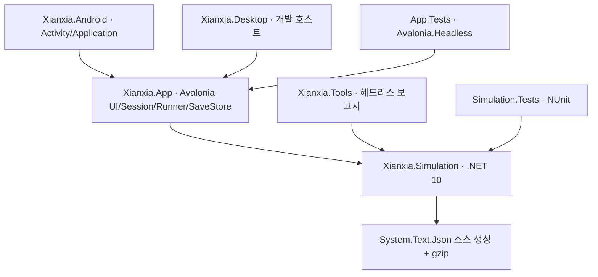
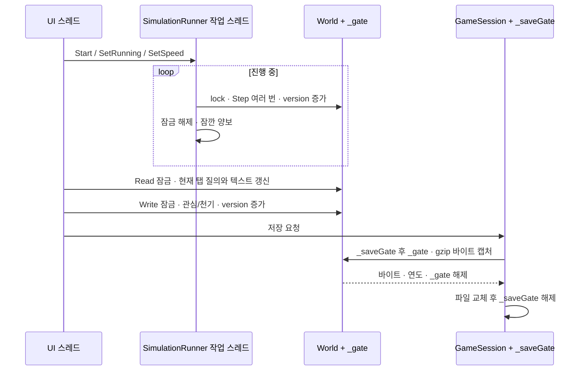

# 05. 기술 아키텍처

> 0.1.0 작성 시점의 설계·검토 기록입니다. 0.2.0 구현과 달라진 사항은 [현재 구현 기준20](20-v0.2.0-implementation.md)과 [실측19](19-balance-v0.2.0.md)를 우선합니다.

상태: 구현 구조를 복원한 기술 명세. 설계 변경 제안은 [11](11-legacy-and-decisions.md), 결함·계약 공백은 [12](12-open-questions.md)에 분리한다.

## 1. 배포·의존 경계

코어는 Avalonia·Android·파일 경로·네트워크를 참조하지 않는다. 화면은 코어 데이터와 계산을 읽는다.
앱 계층이 기기 파일과 스레드·수명 주기를 담당하고 Android 호스트는 플랫폼 이벤트를 연결한다.
React 원본은 비교 자료이며 새 앱이 WebView나 JavaScript 엔진을 통해 실행하지 않는다.
서버·DB·원격 API·계정·서비스 운영 인프라는 없다.

| 프로젝트 | 책임 |
|---|---|
| Xianxia.Simulation | Core/PCG, Data/상수·레이블, Model/상태, Systems/규칙, Persistence/바이트 직렬화 |
| Xianxia.App | Pages·Sheets·Controls·Views, UI 질의, 실행기, 세션, 저장 파일 관리 |
| Xianxia.Android | 세로 Activity, Android 수명 주기, 아이콘·플랫폼 테마, APK 설정 |
| Xianxia.Desktop | 같은 앱의 데스크톱 진입점 |
| Xianxia.Tools | 고정 시드 실행, 분포·전쟁·장부·성능·성장 요인 보고 |
| 두 Tests 프로젝트 | 결정론·불변식·기능·회귀 및 입력·질의·렌더 검사 |

이 경계는 저장소 루트의 Hora.Simulation 등과 별개다. 가까운 `Directory.Build.props`와
`Directory.Packages.props`를 사용한다. 데이터는 현재 **컴파일된 C# 표**이며 런타임 JSON 설정이 아니다.

## 2. 핵심 실행 계약

`WorldFactory.Create(settings)`가 세계를 만들고 `WorldSimulator.Step(world)`이 1년을 처리한다.
`Run(world, years)`는 이를 반복한다. 명령 큐·이벤트 소싱·프레임별 delta-time 시뮬레이션은 없다.
정해진 시스템 순서는 결과에 영향을 준다. 전체 순서와 수식은 [02](02-simulation-rules.md)가 기준이다.

모델은 공개 mutable 클래스와 컬렉션을 사용하고 여러 정적 시스템이 같은 World를 제자리 변경한다.
도메인 계층의 불변 객체나 커맨드 검증 장벽이 모든 상태 변경을 강제하지는 않는다. 실행기의 잠금을
통하지 않는 외부 변경을 형식 시스템이 막지 않으므로 소유권 규약과 테스트가 중요하다.

## 3. 스레드와 동기화

- Runner의 `_gate`가 세계 변경·조회·세계 교체를 직렬화한다. UI 조회에도 같은 mutable World를 넘긴다.
- UI는 250ms마다 버전·dirty 상태를 보고 **선택 탭**과 열린 시트를 갱신한다. 모든 탭을 매번 다시 만들지 않는다.
- `Read` 콜백 중 UI 컨트롤 갱신까지 잠금을 유지하므로 무거운 정렬·렌더 준비가 진행을 막을 수 있다.
- `Write`는 결과가 실패여도 버전을 증가시킨다. `Replace`는 정지하고 World를 교체한다.
- `_saveGate → _gate` 순서로 캡처를 직렬화해 오래된 캡처가 새 저장을 덮는 일을 방지한다.
  압축은 세계 잠금 안, 파일 쓰기는 세계 잠금 밖이다. 파일 쓰기 중에도 저장 요청 간 순서는 보존한다.

단일 Step에는 트랜잭션·롤백이 없다. 시스템 중간에 예외가 나면 연도와 일부 상태가 이미 변경됐을 수 있다.
동일 잠금이 데이터 경쟁을 막는다는 사실은 실패한 해의 원자성을 보장하지 않는다.

## 4. 속도 조절과 자동 저장

Runner는 background `Thread` 한 개와 `Stopwatch`를 사용한다. 선택 속도의 경과 시간 분량을
정수 년 budget으로 계산하고, 밀린 시간은 최대 0.2초 분량으로 제한한다. 최대 속도는 budget을
크게 두고 가능한 만큼 진행한다. 한 묶음은 약 8ms 경과 시 다음 해를 시작하지 않는 방식이다.
**한 해를 중단하지 않으므로 8ms는 잠금 시간의 엄격한 상한이 아니다.** 묶음 후 1ms 양보한다.
측정 년/초는 약 1초 창에서 완료한 해 수다.

정지 중에는 `Monitor.Wait`로 잠든다. 따라서 90초 자동 저장 검사는 진행 루프가 돌아가고 버전이
바뀌었을 때만 실행된다. 정지한 채 관심이나 개입만 바꾸고 90초 기다리는 경우 자동 저장은 보장되지
않는다. 수동 저장·백그라운드 저장·종료 저장은 별도로 있다. 자동 저장 콜백은 세계 잠금 밖이지만
같은 작업 스레드에서 실행되므로 저장 시간만큼 시뮬레이션 진행은 쉰다.

## 5. 결정론과 난수

세계 하나가 **단일 PCG32**를 소유한다. 정수 상태 64비트, 출력 32비트이며 시드와 스트림 상수를
사용한다. 편향을 줄인 `NextInt`, 양 끝 포함 정수 범위, 가중 선택, 실수 범위 API를 제공한다.
난수 상태와 increment를 저장해 중간 저장 후 이어갈 수 있다.

결과 재현의 조건은 같은 소스·시드·설정·세계 입력·입력 시점·컬렉션 처리 순서다. 속도 설정과
렌더링 자체가 난수를 소비하지는 않지만, 관심 여부에 따른 로그 분기가 세계 난수를 소비한다.
난수 수열 안정성과 **관찰 입력을 바꿔도 같은 세계가 되는 성질**은 다른 계약이다.

PCG 정수 참조 수열과 같은 .NET 실행 환경에서의 전체 세계·저장 연속성은 테스트한다.
성장·전투·확률에는 `double`, `Math.Pow`, 반올림이 있으므로 모든 CPU/OS에서 전체 세계가
비트 단위로 같다는 주장은 교차 플랫폼 장기 비교 전까지 보류한다.
시계는 새 시드 선택과 실행 속도·UI 표시 시간에만 사용한다. 코어 연간 규칙은 실제 시각을 읽지 않는다.

## 6. 성능을 위한 현재 선택

| 선택 | 효과 | 한계 |
|---|---|---|
| SoulId 사전·지역 거주자 색인 | 인물 조회, 지역 내 상대 선택 비용 감소 | 저장 로드·이동·윤회 때 정합성 필요 |
| 최신 로그 링 버퍼 600 | O(1) 추가, 로그 누적에 따른 무한 증가 방지 | 과거 전체 사건은 복원 불가 |
| 연대기 1,500·통계 400 제한 | 화면·그래프 규모 제한 | 일부 다른 기록 컬렉션은 무한 증가 |
| 페이지 20명/항목·로그 40건 | 컨트롤 수와 텍스트 갱신 제한 | 정렬 대상 전체 조회 비용이 모두 없어지지는 않음 |
| 화면·붓 재사용 | 갱신 할당과 레이아웃 부담 감소 | 실제 Android 프레임·GC 측정 필요 |
| UI 외 진행 스레드·짧은 묶음 | UI와 진행을 분리 | 공유 잠금·압축·긴 Step에서 지연 가능 |

3만 년 보고서의 코어 평균은 약 0.30~0.39ms/년이지만 클라우드 .NET 호스트 결과다.
모바일 UI 포함 성능·배터리·발열·메모리 목표는 확정되지 않았다. 실측 조건은 [측정 기록](measurements/README.md)을 본다.

## 7. 오류와 수명 주기

연간 진행 중 일반 예외는 Runner가 메시지를 저장하고 정지한다. OutOfMemoryException은 이 경로에서
처리하지 않는다. 다시 진행하면 오류 메시지를 지우지만 실패 전 스냅샷으로 복구하지 않는다.
루프 바깥 자동 저장·직렬화의 모든 예외를 동일하게 포괄하지 않는다.

세션은 앱 단위로 유지된다. Android 백그라운드 진입은 진행 여부를 기억하고 정지·저장,
복귀는 원래 진행 중이었을 때 재개한다. 종료는 Stop 후 저장한다. 프로세스 강제 종료 시 종료
콜백을 보장할 수 없고, 백그라운드 저장은 동기식이다. 파일 복구 계약은 [06](06-data-and-persistence.md)을 따른다.
Runner의 Stop/Start 재사용은 `_stopping` 초기화가 없어 재시작 계약이 없다. 현재 사용은 세션 수명 안에서 한 번 시작·종료하는 방식이다.

## 8. 의존성과 확장 시 지켜야 할 계약

새 규칙은 코어에 두고 화면은 계산 결과를 표시한다. 난수 호출을 추가·삭제하거나 목록 순서를 바꾸면
같은 시드의 후속 이력이 달라질 수 있다. 저장 스키마 변경은 FormatVersion·기본값·마이그레이션과 함께
검토해야 한다. 경제 변경은 생성/소멸/이전의 장부 분류를 유지하고 새 ID 연결은 로드·윤회·비승까지 확인한다.

플러그인·모딩·다국어·클라우드 저장·원격 로그·실시간 멀티플레이를 위한 추상화는 현재 범위에 없다.
확장을 위해 인터페이스를 도입할지는 구체적인 요구가 생긴 뒤 결정한다.

## 9. 근거

- [Runner](../src/Xianxia.App/Services/SimulationRunner.cs), [GameSession](../src/Xianxia.App/Services/GameSession.cs)
- [World](../src/Xianxia.Simulation/Model/World.cs), [WorldSimulator](../src/Xianxia.Simulation/WorldSimulator.cs), [PCG32](../src/Xianxia.Simulation/Core/Pcg32.cs)
- [직렬화](../src/Xianxia.Simulation/Persistence/WorldSerializer.cs), [Data](reference/source-and-tests.md), [공통 빌드 설정](../Directory.Build.props)
