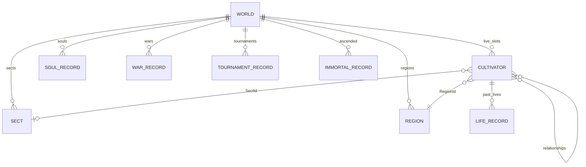

# 06. 데이터·저장 설계

상태: 기준 소스의 데이터 계약. 속성 전체 목록은 [데이터 사전](reference/data-dictionary.md),
실제 숫자·열거형은 [추출 JSON](reference/catalog.json)을 함께 본다.

## 1. 상태 모델과 식별자

이는 메모리·JSON 참조 관계를 보여 주며 관계형 DB의 FK 제약을 구현했다는 뜻은 아니다.

| 식별자 | 의미·주의 |
|---|---|
| Cultivator.Id / SoulId | 양수 영혼 번호. 정상 윤회 시 유지, 비승 후 같은 슬롯에는 새 번호 |
| 인구 슬롯 | Cultivators 목록 위치. 영혼 번호와 동일하지 않음 |
| SectId | 1 청운종, 2 천마문, 0 산수. 실제 Sects 목록 인덱스로 혼용 금지 |
| RegionId | 0~12 지역 목록 인덱스. 0도 유효한 지역이며 링크 없음 표시로 쓰면 안 됨 |
| 전쟁·대회 번호 | 보존 기록의 식별 번호. 상세 조회는 해당 번호로 검색 |
| 관계 ID | MasterId·CompanionId·제자·숙적 등 영혼 연결. 부재·좌화·윤회 처리가 필요 |
| NextSoulId | 다음 영혼 생성 번호. 비승으로 증가하며 현재 인구보다 커질 수 있음 |

`Age`는 현생 나이, `BornYear`는 현재 구현에서 16세 재시작 기준 연도를 가리킨다.
일반적인 `세계연도-만나이` 출생 연도로 해석하면 맞지 않는다. 초기 인물도 `BornYear=-Age+16`이다.
`Settings.Population`은 요청 설정이며 UI를 우회한 범위 밖 입력에서는 Factory의 실제 인구 clamp와
다를 수 있다. 정상 UI 입력에서는 일치한다.

## 2. 주요 집합

| 상태 집합 | 내용 | 수명·보관 |
|---|---|---|
| WorldSettings / RNG state | 시드·요청 인구, 난수 state/increment, 현재 연도 | 저장 대상 |
| Cultivators | 현생 수치·재능·성격·아이템·관계·소속·행동·관심·생애 기록 | 고정 인구 슬롯 |
| Sects / Regions | 금고·시설·직위 집계, 지배·세력·시장·영기 변화 | 저장 대상 |
| War / Era / 활성 사건 | 현 전쟁, 시대, 비경·수조 상태 | 저장 대상 |
| Wars / Tournaments / Immortals / Souls | 종료 전쟁·대회·비승·영혼 업적 | 현재 개수 상한 없음 |
| Logs | 최신 사건과 종류별 누계 | 최신 600건 링 버퍼 |
| Chronicle | 세계 연대기 | 최신 1,500건 |
| Statistics | 시간별 표본·집계 | 표본 최대 400, 넘으면 간격을 늘려 압축 |
| Auctions | 최근 경매 결과 | 최신 30회 |
| Biography / PastLives / BestLifeScores | 인물 생애·전생·상위 점수 | 40 / 20 / 5개 |
| Notices | UI 알림 대기열 | 40개, 저장 제외 |

생애 기록 40개가 넘으면 첫 항목을 보존하고 두 번째 항목을 지운다. 전체 서사를 무제한 보존하지 않는다.
컬렉션별 실제 속성·읽기/쓰기 가능 여부·JsonIgnore는 데이터 사전에서 확인한다.
getter 전용 집계 속성이 JSON에 나타나는 것과 불러오기 시 재주입되는 것은 다르다.

## 3. 직렬화 형식

| 항목 | 현재 형식 |
|---|---|
| 파일 | 앱 전용 폴더 `XianxiaObserver/world.sav` 한 개 |
| 기본 경로 | `Environment.SpecialFolder.LocalApplicationData`; 비어 있으면 AppContext.BaseDirectory |
| 컨테이너 | gzip, CompressionLevel.Fastest |
| 본문 | System.Text.Json 소스 생성 컨텍스트의 World JSON |
| 버전 | FormatVersion=1. 저장할 때 현재 버전으로 설정 |
| 이름·enum | C# 속성 이름, enum은 기본 정수 값 |
| 난수 | ulong state/increment를 JSON 수로 저장하고 로드 시 PCG 객체 재생성 |
| 보안·검증 | 암호화·전자서명·별도 저장 해시·의미 검증 스키마 없음 |

실제 저장 일부를 [save-example.json](reference/save-example.json)에 발췌했다. **발췌는 완전한
저장 파일이 아니며 직접 불러오는 용도가 아니다.** 원본 플레이어 저장이나 비밀정보를 포함하지 않는다.
외부 JavaScript 도구는 64비트 RNG 수를 Number로 변환하면 정밀도를 잃을 수 있으므로 정수 보존
파서나 문자열 표현을 사용해야 한다. gzip CRC는 상태의 의미적 유효성을 검사하지 않는다.

## 4. 저장 처리

1. 세션 `_saveGate`를 잡아 동시 저장·불러오기 순서를 정한다.
2. Runner의 세계 잠금에서 RNG·주민 ID 목록 등 저장용 상태를 캡처하고 gzip 바이트를 만든다.
3. 세계 잠금을 놓는다. `_saveGate`는 계속 유지한다.
4. 같은 디렉터리 `world.sav.tmp`에 전체 바이트를 쓴다.
5. `File.Move(..., overwrite:true)`로 `world.sav`를 교체한다.
6. 결과 메시지를 갱신하고 저장 잠금을 해제한다.

임시 파일 교체는 부분 본문을 기존 슬롯에 직접 쓰는 위험을 줄인다. 그러나 fsync·디렉터리 flush·
저장 세대 백업·교체 후 자동 재읽기·디스크 부족 복구를 구현한 것은 아니다. 전원 차단에도 마지막
저장이 반드시 유지된다고 약속할 수 없다. `.tmp`를 다음 시작에 복원하는 절차도 없다.

수동 저장, 새 세계 생성 직후, 진행 루프의 약 90초 간격, 백그라운드·종료 때 요청한다.
정지 상태의 자동 저장 예외는 [05](05-architecture.md)를 본다. 새 세계와 저장 불러오기 모두 단일 슬롯을 사용한다.

## 5. 불러오기·호환성

gzip을 풀고 JSON을 World로 변환한 뒤 지원 버전을 확인하고 RNG·사전·지역 거주자 색인을 복원한다.
누락된 일부 목록·배열은 현재 기본값 또는 길이에 맞춰 보완한다. 저장한 거주자 순서를 가능한 유지하고
누락 인물을 보충하므로 난수 대상 선택의 순서도 보존하려 한다. 목록 순서를 임의 정렬하는 마이그레이션은
같은 난수 상태에서도 이후 결과를 바꿀 수 있다.

현재 로드는 미래 FormatVersion, 빈 인구, 손상된 gzip·JSON 등 일부 구조 오류를 거부한다.
버전 0·음수의 엄격한 거부나 버전별 완전한 마이그레이션 테이블은 없다. 파일 크기·압축 해제 크기·
ID 유일성·범위·모든 필드의 null·NaN/무한대·참조 무결성을 포괄 검증하지 않는다.

`SaveStore.TryLoad`는 SaveFormatException이면 `.broken`으로 옮기고 새 세계를 허용하며,
IOException·UnauthorizedAccessException이면 안내한다. `.broken`은 덮어쓸 수 있어 여러 손상 파일을
보존하지 않는다. 색인 복원 중의 예기치 않은 ArgumentOutOfRangeException 등은 이 처리 범위 밖이다.
RegionId=999인 유효 gzip JSON에서 해당 예외를 재현했다([OQ-03](12-open-questions.md)).
따라서 “임의의 손상 저장에서 안전하게 복구한다”는 수용 기준은 아직 충족됐다고 볼 수 없다.

## 6. 정상 세계의 불변식

아래는 주로 장기 시뮬레이션 테스트로 확인하는 조건이다. 외부 저장 입력에 모두 강제한 제약은 아니다.

| 불변식 | 현재 확인 방법 |
|---|---|
| 생존 인구 일정 | 윤회·비승 기능 검사, 장기 Population 검사 |
| 인물은 정확히 한 지역에 존재 | 주민 색인 검사, 저장 후 색인 재구축 검사 |
| 종문 직위·정원·종주 정합 | RankCounts·Leader·Rogue 검사와 회귀 사례 |
| 스승/제자·도려 관계 정합 | Relationships 검사, 유산·숙적 기능 검사 |
| 경지·단계·부상·자원 등 정상 범위 | CultivatorValues·SoulRecords 검사 |
| 영석 총량 | 살아 있는 개인+종문 금고 = Ledger.Created-Ledger.Destroyed |
| 같은 입력의 재현 | 같은 시드 직렬화 비교, 저장 전후 이어가기 비교 |

영석은 보유량·장부에 정수를 쓰고 일부 가격·이율 계산에 실수 중간값을 사용한다.
약초·영철·아이템의 실물 보존, 사망 후 모든 자산의 외부 계정 귀속, 시장 가격 형성까지 검증하는
회계 모델은 아니다. 루트 Hora 프로젝트의 Money 센트 규칙과 혼동하지 않는다.

## 7. 변경·개인정보·복구 제안

열거형 순서를 바꾸면 기존 저장의 의미가 바뀐다. 끝에 추가하거나 명시적 마이그레이션을 해야 한다.
상수 변경은 새 세계뿐 아니라 이어 하는 세계의 결과도 바꿀 수 있다. 새 버전에서 저장 호환성을 보장하려면
이전 버전의 대표 저장 fixture와 정합성·진행 검사를 추가해야 한다.

현재 저장은 절차 생성 인물과 관찰 상태이며 사용자의 이름·계정·위치를 수집하지 않는다.
Android manifest는 allowBackup=true다. 자체 클라우드 동기화는 없지만 플랫폼 백업 가능 여부와
사용자 기대는 별도 검토가 필요하다. 제안은 의미 검증 후 교체, 크기 상한, 세대 백업, 내보내기/가져오기,
오류 시 마지막 정상 스냅샷 유지다. 범위·UX·수용 기준은 아직 결정되지 않았다.

## 8. 근거

- [WorldSerializer](../src/Xianxia.Simulation/Persistence/WorldSerializer.cs), [World](../src/Xianxia.Simulation/Model/World.cs)
- [SaveStore](../src/Xianxia.App/Services/SaveStore.cs), [GameSession](../src/Xianxia.App/Services/GameSession.cs)
- [모델 전체 사전](reference/data-dictionary.md), [결정론 검사](../tests/Xianxia.Simulation.Tests/DeterminismTests.cs)
