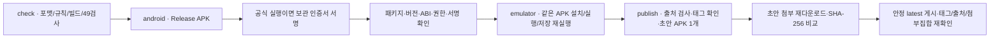

# 07. Android·빌드·배포

상태: 현재 개발·배포 절차와 v0.1.0의 출처 기록. 이 문서 작성에서는 재배포하지 않았다.

## 1. 개발 도구와 의존성

| 항목 | 저장소 설정 |
|---|---|
| SDK | .NET 10, global.json 10.0.100 + latestFeature rollForward, prerelease 제외 |
| 일반 프로젝트 | net10.0 |
| Android | net10.0-android, Android workload, Java 17, SDK/platform·build-tools 36 |
| UI | Avalonia 12.1.4 계열을 중앙 관리 |
| 검사 | NUnit 4.6.1, NUnit3TestAdapter 6.3.0, Microsoft.NET.Test.Sdk 18.10.1 |
| 패키지 | nuget.org만 사용, 일반 프로젝트 packages.lock.json과 locked restore |
| 컴파일 | Nullable on, ImplicitUsings off, warnings as errors, latest-recommended 분석, XML 문서 |
| 전역화 | InvariantGlobalization=true, satellite language ko |
| 개발 OS | CI Ubuntu 24.04. 데스크톱 실행은 해당 OS의 Avalonia 요구사항 필요 |

Android workload 종속 패키지는 환경에 따라 달라 해당 프로젝트는 잠금 파일을 생성하지 않는다.
SDK의 latestFeature와 CI `10.0.x`도 완전 고정된 바이트 재현 빌드를 뜻하지 않는다.
같은 소스의 재빌드와 이미 검증한 APK의 동일 바이트 재사용을 구분한다.

## 2. 로컬 실행·검사

아래 명령은 `games/xianxia-observer/`에서 실행한다. 루트의 다른 게임 SDK 설정과 혼용하지 않는다.

```sh
dotnet restore XianxiaObserver.slnx --locked-mode
dotnet format XianxiaObserver.slnx --verify-no-changes --no-restore
bash ../../tools/check-code-rules.sh .
dotnet build XianxiaObserver.slnx -c Release --no-restore -warnaserror
dotnet test XianxiaObserver.slnx -c Release --no-build --logger trx --results-directory TestResults
dotnet run --project src/Xianxia.Desktop
```

`XianxiaObserver.slnx`는 Android workload 없이 검사 가능한 프로젝트만 포함한다.
Android는 별도로 빌드한다.

```sh
dotnet workload install android
dotnet publish src/Xianxia.Android/Xianxia.Android.csproj -c Release -f net10.0-android
```

이 로컬 publish 결과를 공식 게시자 인증서로 서명한 배포 APK라고 간주하지 않는다.
공식 서명은 CI의 보관된 게시자 키를 사용한다. 개발 환경으로 키스토어를 복사하지 않는다.

## 3. 패키지 계약

| 항목 | 현재 값 |
|---|---|
| 표시 이름 / ID | 선협 관찰 / `org.hora.xianxiaobserver` |
| 버전 이름 / 코드 | 0.1.0 / 1 |
| 최소 Android | API 24. 실제 API 24 실행 검증은 미실시 |
| 현재 빌드 SDK | API 36 |
| ABI | arm64-v8a + x86_64를 포함한 APK 한 개 |
| 화면 | Portrait 고정, 구성 변경 시 Activity 재생성 최소화 |
| 권한 | INTERNET 없음. manifest에 별도 권한 요청 없음 |
| 백업 | allowBackup=true, supportsRtl=false |
| 패키지 형식 | APK, Profiled AOT 비활성 |
| 스토어 정책 | Play Console 배포·AAB·공식 등급 등록은 현재 범위 밖 |

아이콘은 밀도별 mipmap, 원형 아이콘, API 26+ adaptive icon을 제공한다.
[make-app-icons.py](../tools/make-app-icons.py)가 리소스를 생성하며
[폰트 생성 도구](../tools/make-font-subset.py)는 내장 Noto Serif KR 부분집합을 만든다.
OFL 원문은 [폰트 폴더](../src/Xianxia.App/Assets/Fonts/OFL.txt)에 보관한다.
이미지·폰트 생성 도구의 Python 의존성은 게임 실행 의존성이 아니다.

## 4. CI 단계와 권한

워크플로는 [xianxia-observer.yml](../../../.github/workflows/xianxia-observer.yml)이다.
이 경로는 저장소 루트 `.github/workflows/xianxia-observer.yml`을 가리킨다.



push/PR은 검사·Android 빌드·에뮬레이터 경로를 실행한다. 공개 게시는 `workflow_dispatch`의
`publish=true`, 원본 저장소, 저장소 소유자 actor 조건을 모두 만족할 때만 실행한다.
기본 권한은 contents:read이며 게시 job만 contents:write를 갖는다.
`source_run_id`를 사용하는 재게시 job은 actions:read도 필요하다. 일반 PR 실행은 릴리스를 게시하지 않는다.

체크 보고서·헤드리스 화면·APK·에뮬레이터 로그는 Actions 아티팩트에 보존하며 설정상 14일 후 만료될 수 있다.
공개 릴리스 첨부는 **APK 한 개**다. 문서·ZIP·로그·서명 보고서·소스 묶음을 추가 첨부하지 않는다.
GitHub가 자체 제공하는 자동 Source code 링크와 수동 업로드한 release asset은 구분한다.

## 5. 서명과 출처 검증

[retained-sign.sh](../tools/retained-sign.sh)는 CI secret bundle 또는 기존 보관 형식을 해석하고,
기존 게시자 인증서의 고정 SHA-256과 일치하는 키만 사용한다. 보관 bundle의 `alpha-exchange`/
`com.alphaexchange.offline` 표기는 **기존 키 보관용 식별자**다. 새 APK의 applicationId는 별도로
`org.hora.xianxiaobserver`임을 검사한다. 키를 새로 생성하거나 다른 게임 APK를 재게시하지 않는다.

서명 전 해시, 서명 후 인증서, APK ZIP의 서명 관련 항목을 제외한 모든 payload 해시를 확인한다.
`SIGNING-VERIFICATION.json`에는 소스 커밋·공개 인증서 지문·입출력 해시·패키지 정보만 기록하며
개인키·비밀번호·토큰은 기록하지 않는다. 임시 키 파일은 CI 임시 경로에서만 사용·정리한다.

[publish-release.py](../tools/publish-release.py)는 저장소·실행·소스 SHA와 세 검사 job의 성공,
서명 증빙·APK 해시를 확인한다. 태그가 다른 소스를 가리키거나 이미 공개된 같은 버전을 덮어써야 하면
중단한다. 태그를 먼저 검증·생성하고 초안 수정 시 tag_name을 유지한다. metadata PATCH에는
불필요한 target_commitish 변경을 넣지 않는다. 첨부 이름·개수·digest·크기도 게시 전후 확인한다.

## 6. 게시만 재시도하는 절차

검사·서명·에뮬레이터가 성공하고 게시만 실패한 경우 workflow_dispatch에서 원본 `source_run_id`와
`publish=true`를 지정한다. 같은 실행의 run_attempt에 해당하는 아티팩트를 받아 **재빌드 없이** 게시한다.
아티팩트가 만료됐거나 출처·검사가 맞지 않으면 이 재시도 경로를 사용할 수 없다.

CLI는 원본 실행의 정확한 APK와 서명 증빙을 저장소 루트 `release-input/`에 두고 다음 단계를 사용한다.
토큰은 안전하게 설정된 실행 환경에서만 사용한다.

```sh
python3 games/xianxia-observer/tools/publish-release.py prepare --source-run <run-id>
python3 games/xianxia-observer/tools/publish-release.py readback --source-run <run-id>
python3 games/xianxia-observer/tools/publish-release.py publish --source-run <run-id>
```

새 버전은 Android 버전 이름·증가한 versionCode, workflow env, 서명/게시 도구의 버전·파일명·태그,
릴리스 노트를 함께 갱신한다. 기존 태그·공개 asset을 이동·교체하는 방식으로 업데이트하지 않는다.
롤백도 설치된 높은 versionCode 위에 낮은 APK를 일반 업데이트할 수 없다는 점을 고려해 새 코드로 배포한다.

## 7. v0.1.0 공개 출처

| 항목 | 값·증거 |
|---|---|
| 소스 | `f8838425f6a3303d11171605abba47008862491c` |
| 원본 검사·서명·Android 실행 | [Actions 40672439072](https://github.com/hddy774/project-hora/actions/runs/40672439072) |
| 게시 재시도 성공 | [Actions 40675821395](https://github.com/hddy774/project-hora/actions/runs/40675821395) |
| 릴리스 | [xianxia-observer/v0.1.0](https://github.com/hddy774/project-hora/releases/tag/xianxia-observer/v0.1.0) |
| 공개 파일 | [XianxiaObserver-v0.1.0.apk](https://github.com/hddy774/project-hora/releases/download/xianxia-observer/v0.1.0/XianxiaObserver-v0.1.0.apk) |
| 크기 | 42,653,254바이트 |
| APK SHA-256 | `c6e0bd9c499ea18d2cc9844250e3631e6ef6993f66b0f76a0c7d6aa252705761` |
| 인증서 SHA-256 | `0832f24441f1caf335166fbc16ae0b9536e262ca48f258926a8027fc31dca25a` |

기준 커밋 17b48ad와 APK 소스 사이의 `src/`, `tests/`, 두 공통 props에는 차이가 없다.
후속 변경은 게시 도구·워크플로·문서다. 공개 다운로드 해시도 위 값과 대조했다.
Android 입력 검증의 구체적 한계는 [08](08-validation.md)에서 확인한다.
