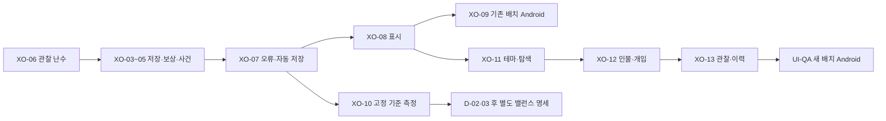

# 14. 개발 순서와 진행 관리

기획일: 2026-10-29. 사용자 요청: PR #29 이후 개발 계획, UI·UX 배치 개선, PR의 개발 중·완료 체크표.
기준: PR #29 병합 `cf43de6`. 이번 변경은 기획·시안·진행 관리이며 게임 기능 구현과 구분한다.
테마는 사용자가 지정한 **고서 목판**이다. 화면별 상세는 [15](15-ui-ux-improvement.md)를 따른다.

## 1. 출발점과 승인

PR #28의 v0.1.0 배포·문서와 PR #29의 검토·명세 작성은 완료됐다. XO-03~10의 게임 코드는 아직 구현되지 않았다.
**D-01(관심은 순수 관찰), D-09(수정 후 같은 시드의 미래 변경 허용), XO-06만 기존 승인 상태**다.
이번 기획 요청을 다른 명세나 밸런스 목표의 일괄 승인으로 기록하지 않는다.

제품의 첫 목표는 저장·관찰·보상에 대한 신뢰 회복, 다음 목표는 작은 화면에서 관심 인물과 사건을 쉽게 읽는 것이다.
출시 범위는 두 후보로 나눈다. 안정화 후보 S는 기존 7탭을 유지한다. UI 후보 U는 새 배치를 적용하고 Android 입력을 다시 확인한다.
버전 번호와 S/U를 함께 배포할지는 D-08에서 정한다.

## 2. 권장 개발·통합 순서

아래 순서는 동시 편집 충돌과 측정 기준 변경을 줄이기 위한 권장 통합 순서다. 코드의 필수 선행과 승인 조건은 별도 열이다.
개발 작업 하나당 구현 PR을 만들고, 앞 작업의 변경을 받은 기준에서 검증한다.

| 순서 | 작업 | 결과물·완료 증거 | 필수 선행·결정 |
|---:|---|---|---|
| 1 | [XO-06](../../../docs/tasks/XO-06-follow-rng-isolation.md) | 관심 0/1/전원/중도 추가 A/B와 저장 연속성, 관심1,000명 측정 | 승인됨. 바로 착수 가능한 작업 |
| 2 | [XO-03](../../../docs/tasks/XO-03-save-validation.md) | 의미 손상·크기·격리 검사, 정상 로드 회귀·시간 | 명세 승인·D-06 |
| 3 | [XO-04](../../../docs/tasks/XO-04-technique-reward-monotonic.md) | 전 등급 보상 단조성·난수 호출 수 회귀 | 명세 승인 |
| 4 | [XO-05](../../../docs/tasks/XO-05-region-event-overlap.md) | 사건 시작/종료 조합·로드 재계산·실패 시 천기 불변 | XO-03 후 같은 로드 파이프라인에 통합, 본산 개입 정책·명세 승인 |
| 5 | [XO-07](../../../docs/tasks/XO-07-runner-fault-and-autosave.md) | 실패 세계 격리 → 정지 자동 저장 → 정상본 백업 순 구현 | XO-03·D-06·명세 승인 |
| 6 | [XO-08](../../../docs/tasks/XO-08-labels-and-records.md) | 도감·표시·기록 의미 일치, 좁은 화면 확인 | D-04·D-05·명세 승인 |
| 7 | [XO-09](../../../docs/tasks/XO-09-android-input-acceptance.md) | 기존 7탭 API24/34 입력·상세·백그라운드·재실행 증거 | 안정화 코드 고정·D-07·명세 승인 |
| 8 | [XO-10](../../../docs/tasks/XO-10-balance-report.md) | 같은 기준 커밋의 10시드·장기 저장 보고 | XO-03~07 통합·명세 승인. D-02/03의 판단 자료 |
| 9 | [XO-11](../../../docs/tasks/XO-11-woodblock-navigation.md) | 고서 목판 토큰·공통 프레임·5탭/더보기·속도 패널 | XO-07, 새 배치 명세 승인 |
| 10 | [XO-12](../../../docs/tasks/XO-12-people-and-detail-ux.md) | 인물 검색/관심/상세 복귀·개입 확인·저장 복구 UX | XO-11·XO-06·XO-05, 명세 승인 |
| 11 | [XO-13](../../../docs/tasks/XO-13-observation-and-history.md) | 천하 관찰 진입·사기/기록 탐색·빈 상태 | XO-12·XO-08, 명세 승인 |
| 12 | UI-QA | 5개 주 탭 + 더보기의 3개 기존 화면, 큰 글자·IME·뒤로·노치 재검증 | XO-11~13·XO-09, UI 수용 기준 승인 |

저장 파일·World·Serializer를 공유하는 작업은 순차 통합한다. XO-10은 UI 변경과 독립적이지만
코어 기준 커밋을 고정하고 실행한다. 측정 중 규칙·난수·필드 의미를 바꾸면 새 기준으로 다시 측정한다.

## 3. 착수 전에 명세에서 정리할 경계

- XO-03: 검사 전 접근할 수 있는 null 목록, Normalize가 보완하는 필드, 새 LogRandom 필드를 구분한다.
- XO-06: 상태값0 자체는 PCG에서 유효하다. 구 저장 판별은 명세 규칙의 `LogRandomIncrement==0`으로 통일한다.
- XO-07: Step **직전** 예외만으로 부분 변경 격리를 입증하지 못한다. 필드 일부를 바꾼 뒤 예외를 내는 회귀도 포함한다.
- XO-09: 단계마다 logcat 커서를 새로 잡아 이전 로그를 재사용하지 않는다. 이미 선택된 첫 탭은 다른 탭을 거쳐 복귀해 판정한다.
- UI-QA: 기존 XO-09의 7등분 좌표를 새 5탭에서 재사용하지 않는다. 새 탐색 ID·실제 터치 영역과 필수 경로를 검사한다.

## 4. 결정과 범위

| 결정 | 현재 상태 | 계획에서 적용하는 원칙 |
|---|---|---|
| D-02·03 비승·종문 균형 | 대기 | XO-10 결과 후 확정. 이번에는 계수를 바꾸지 않음 |
| D-04·05 신품·기록 의미 | 대기 | XO-08의 표시 변경을 승인받은 뒤 적용 |
| D-06 백업·격리 | 대기 | XO-03·07은 제안된 1세대 정상본/3개 손상본을 승인 전제로 작성 |
| D-07 최소 지원·실기기 | 대기 | API24 유지 후보, API24/34와 ARM64 결과를 출시 전에 확인 |
| D-08 출시 묶음 | 대기 | S 안정화와 U 배치를 별도 후보로 관리 |
| 본산 개입 | 대기 | XO-05 #10을 구현 전 확정. 기존 허용을 조용히 차단하지 않음 |
| 고서 목판 테마 | 사용자 지정 | [참조 이미지](design/woodblock-reference.jpg)와 15의 토큰 적용 |
| 5탭·4개 인물 분류·접근성 수치 | 개선 제안 | 시안과 수용 기준을 검토 후 UI 명세 승인 |

## 5. 진행표와 완료 정의

현재 상태 원본은 [xianxia-progress.json](../../../docs/tasks/xianxia-progress.json), 공개 보드는 [PR #29](https://github.com/hddy774/project-hora/pull/29)의 지정 영역이다.
기반 완료·기획 완료와 신규 개발12건의 완료율을 분리한다. 승인과 실행 상태도 따로 관리한다.
`예정 → 개발 중 → 검증 중 → 완료`, 막히면 이유·필요 결정과 함께 `차단`으로 바꾼다.

착수 직전, 구현 커밋을 올릴 때, 검사 시작·결과 확인 때, 차단·재개 때 각각 상태를 갱신한다.
진행 갱신 도구의 `set … --publish` 명령이 PR #29 본문을 즉시 갱신하며 다른 PR은 `--pr`로 지정한다.
명령과 원본 갱신 규칙은 [16](16-progress-tracking.md)에 있다. 변경되는 것은 표식 안의 진행표뿐이다.

완료는 수용 기준 충족·필수 검사 통과·커밋/PR/CI 근거 첨부다. 문서 작성·체크 표시·커밋 생성만으로 코드 완료를 표시하지 않는다.
구현 PR에는 명세, 변경 범위, 저장/난수 영향, 검사 결과, UI 전후 화면을 적는다.
XO-09의 코드·CI 완료와 실기기 결과를 구분하고, 배포 전 D-07·D-08과 실기기 입력·저장 업데이트 결과를 확인한다.
