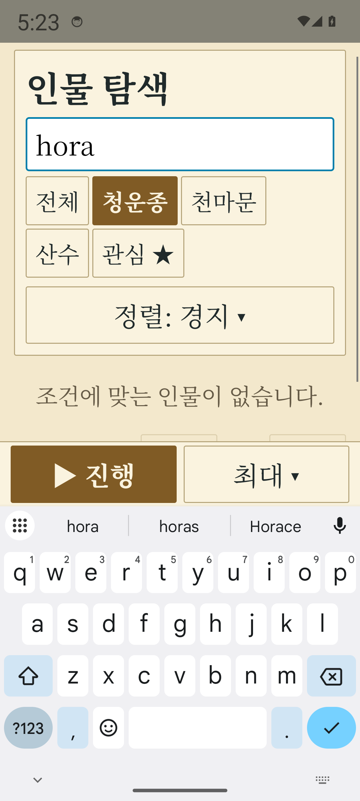

# 선로만상록 프로젝트 0.2.0 Android 수용 증거

후보 검증 완료: [40919843068](https://github.com/hddy774/project-hora/actions/runs/40919843068).
API24·34 모두 성공했고 같은 APK를 설치했다. 공식 게시도 완료했다. 아래 후보 검증 기록과 공식 배포 출처를 구분한다.

| 항목 | 증거 |
|---|---|
| 서명 APK 빌드 | 40916370619 / source 79bcd71f1ace288e15fd35b52b8ac2833af34fe7 |
| 검사 코드 | bef3782aff2e2c069543e9d66028fb9ba318af25 |
| APK SHA256 | 7dd3c1c05d36ab033f747024a7aa17798050d1a8a4e13e237e47fa8c98dd1fc3 |
| API24 아티팩트 | 12918321194 · PNG47개·tested-apk-sha256.txt |
| API34 아티팩트 | 12918556196 · PNG47개·tested-apk-sha256.txt |
| API24 실제 구 저장 | 연도572·인구1000·SHA256 dc89b97420d8f5a9ded7eca6783b11d1f401d6aaa2d2e2658031a4b3a610cd42 |
| API34 실제 구 저장 | 연도24·인구1000·SHA256 7d78274d830efeaf1c7608166549de794e5509a421a959b86c9efadd153daf8d |

실제0.1.0 APK가 만든 gzip 저장을 CI 에뮬레이터에서 읽었다. 업데이트 설치 전후 파일 해시와
새 앱의 정확한 복구 연도를 대조했다. 합성 저장이나 새 세계 시작으로 대체하지 않았다.

각 API에서 다섯 주 탐색·더보기의 세 하위 경로, 인물4분류·7상세, 기연 취소/정상1회 차감,
전쟁/대회 실제 기록, IME 입력·뒤로, 100/130/200%·다시100%, 백그라운드 저장/재실행을 확인했다.
IME에서 진행 조작 좌표가 실제 키보드 가림 영역 위인지 검사했고200% PNG를 직접 확인했다.
런처 창 포커스는 거부하는 음성 대조를 보관했고60초 진행 중 [xo-ui] 로그0줄을 확인했다.

API24의 Unknown 도구는 터치스크린에서만 Finger로 정규화한다. API34 초기 렌더의 readback 전 좌표와
글자 설정 후 변하는 시스템바/IME의 중간 좌표로 누르던 검사를 수정했다. 명세의 초기5초를 복구하고
설정 후2초 동안 native inset 반영을 기다린다. 실제 입력 후 새 전환2초 기준은 유지한다.
자동 진행은 최초 입력 영역이 준비된 뒤 시작하고 먼저 들어온 수동 입력 의도를 보존한다.

소스 CI는 Simulation115·App56 회귀, 포맷·규칙·경고0 빌드와 Python 검사를 통과했다.
개별 과거 실패 실행은 통과로 세지 않는다. 후보 재사용 QA는 게시가 비활성화되어 있으며,
공식 APK는 main의 고정 SHA에서 새로 서명하고 두 API 검사를 다시 거쳐 한 개만 최신 안정 릴리스에 게시한다.

물리 ARM64 기기는 사용자 답변으로 연결할 수 없어 미실행이다. 발열·장시간 실기기 성능도 미실행이며
에뮬레이터 결과로 대체하지 않는다. 저장소 설명 변경 권한403은 별도 이슈#67에서 추적한다.

## 공식 최신 안정 릴리스 — 완료

- [공식 APK](https://github.com/hddy774/project-hora/releases/tag/xianxia-observer/v0.2.0), 첨부 APK1개·43,505,222바이트.
- main/태그 소스: `09e8c693e3ebb52d2495bffb1a48364eb9396dce` (대표 PR#32 squash).
- [공식 빌드·두 API](https://github.com/hddy774/project-hora/actions/runs/40923068393): 모든 소스/서명/실입력 검사 성공.
- [같은 APK 게시](https://github.com/hddy774/project-hora/actions/runs/40925267131): 초안 재다운로드 확인 후 최신 안정 게시 성공.
- 공식 APK SHA256: `b381a400514ea311117bb2b28d15c68baffc00d4ea71a689c9140a69867bf2df`.
- 공식 API24/34 각각47 PNG와 tested-apk-sha256.txt를 다시 내려받아 공개 파일과 같은 해시임을 확인했다.
- 공개 APK를 직접 재다운로드하고 v2 서명 블록의 인증서 지문이 기존 PIN과 같은지, ARM64/x86_64가 함께 있는지 확인했다.
- 태그가 위 main SHA를 가리키고 latest가 이 태그이며 draft/prerelease가 아니고 assets가 APK1개인지 확인했다.

처음 공식 실행의 게시 작업은 선택적 QA 작업이 skipped인 선행 경로 때문에 건너뛰어졌다.
이미 검증된 동일 APK의 게시 전용 경로로 완료했고 재빌드/교체하지 않았다. 후속 운영 보정은
publish 조건에 always()/취소 방지/직접 선행3개 success를 명시한다. 검증 실패·취소·QA 전용 실행은 게시하지 않는다.
공식 APK의 게임 코드와 서명 출처는 위 고정 SHA이며 이후 문서/워크플로 보정 커밋과 구분한다.
